---
# An explicit title slide is authored below; do not generate an automatic one.
format:
  revealjs:
    theme: [default, styles.scss]
    width: 1280
    height: 720
    margin: 0.04
    controls: true
    progress: true
    hash: true
    transition: fade
    navigation-mode: linear
    slide-number: c
    show-slide-number: all
    center: false
    auto-stretch: false
    scrollable: false
    code-overflow: wrap
    html-math-method: mathjax
    footer: "Muhammad Zikriya  |  Deep Learning for Sequential Data"
execute:
  enabled: false
---

## Recurrent Neural Networks & LSTMs {.title-slide .nostretch}

<div class="title-kicker">DEEP LEARNING FOR SEQUENTIAL DATA</div>

<div class="title-subtitle">From recurrent states to gated memory</div>

<div class="title-presenter">Muhammad Zikriya</div>

<div class="title-art">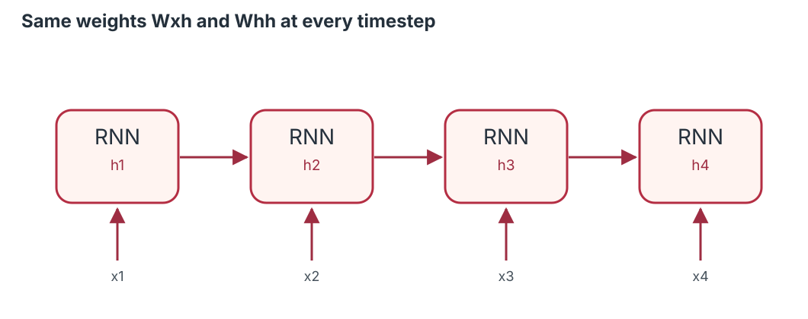</div>

<!-- UFPE AND GEDAI: ONLY ON THIS FIRST SLIDE. Fixed dimensions also work if custom CSS fails. -->
<div class="title-logo-row" style="display:flex; justify-content:center; align-items:center; gap:18px; max-width:560px; margin:28px auto 0; padding:0;">
<div class="title-logo-card" style="width:225px; max-width:45%; height:100px; background:#ffffff; border-radius:10px; display:flex; align-items:center; justify-content:center; padding:7px 10px; box-sizing:border-box;">

  </div>
<div class="title-logo-card" style="width:225px; max-width:45%; height:100px; background:#ffffff; border-radius:10px; display:flex; align-items:center; justify-content:center; padding:7px 10px; box-sizing:border-box;">

</div>
</div>

::: {.notes}
**Opening (instructor):** Introduce sequential data, recurrent networks, and why gated memory is useful. Explain that the lecture combines mathematical intuition, worked calculations, and experiments in R and Python.

**Expanded four-hour teaching guidance:** Begin with the distinction between observing a vector and observing a history. State explicitly that the lecture is a conceptual and computational treatment of sequential learning. Describe how the original recurrent construction is reused at each timestep. Preview three applied contexts: forecasting, language classification, and monitoring. Ask participants to think of a sequence in their own discipline. Emphasize that the logos identify the institution only on this title slide; they are not repeated on content slides.

**Checkpoint:** Before advancing, ask one learner to restate the central equation or diagram in their own words. If the class is unsure, repeat the numerical or graphical interpretation; use the next slide only after resolving the mismatch.

:::

## Why does order matter?

::::: {.slide-content}

::: {.columns}
::: {.column width="52%"}
- "The dog chased the child" vs "The child chased the dog".
- In forecasting, yesterday may help predict tomorrow.
- In monitoring, an unusual *pattern* may matter more than one unusual value.

::: {.takeaway}
A sequence is **more than a set of observations**.
:::
:::
::: {.column width="48%"}
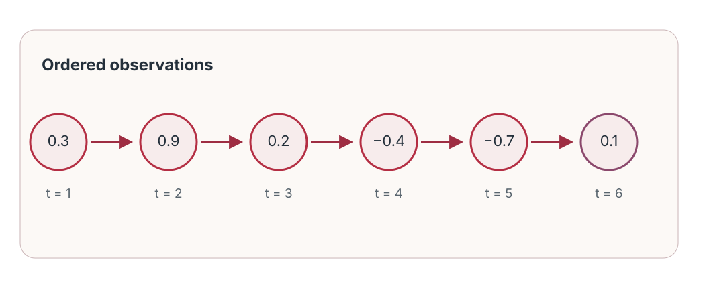
:::
:::

:::::

::: {.notes}
**Instructor timing:** approximately 2 minute(s). **Section:** Introduction.

Ask: If we permute the order of a sentence or hourly temperature readings, does the interpretation remain? Not usually. Point out that ordering, dependency, and variable sequence lengths motivate recurrent computation.

**Expanded four-hour teaching guidance:** Use the two sentences to show that a bag of words would preserve the same words but can destroy meaning. For forecasting, a time-indexed covariate may influence the target after a delay; for monitoring, a slow drift can matter more than an individual extreme measurement. Clarify that not every sequential task needs an RNN: lagged linear or tree models are viable alternatives. Invite students to propose a case where reversing the data order fundamentally changes the question.

**Checkpoint:** Before advancing, ask one learner to restate the central equation or diagram in their own words. If the class is unsure, repeat the numerical or graphical interpretation; use the next slide only after resolving the mismatch.

::: 

## Prediction challenge: what comes next?

::::: {.slide-content}

::: {.question}
**Quick poll (40 seconds):**  2, 4, 6, 8, **?**
:::

::: {.fragment}
Easy when the rule is local and clear: **10**.
:::

::: {.fragment}
But real sequences can contain delayed effects, noise, nonlinearity, and evolving regimes.
:::

::: {.card}
A model needs a representation of **what has happened so far**.
:::

:::::

::: {.notes}
**Instructor timing:** approximately 2 minute(s). **Section:** Introduction.

Reveal the obvious next term after students respond. Explain that realistic sequences are not tidy arithmetic progressions; prior context can be uncertain or many steps old. Transition to hidden state as a learned summary of history.

**Expanded four-hour teaching guidance:** After the arithmetic pattern, present 2, 4, 6, 8, 9 and ask whether the next term is determined. The point is not that an RNN extrapolates mathematical sequences perfectly; instead it learns statistical regularities from training examples. Explain that temporal prediction requires a training distribution, evaluation protocol, and error criterion. Ask which additional information is needed to make a meaningful forecast, then transition from toy rules to observed stochastic sequences.

**Checkpoint:** Before advancing, ask one learner to restate the central equation or diagram in their own words. If the class is unsure, repeat the numerical or graphical interpretation; use the next slide only after resolving the mismatch.

::: 

## Learning roadmap

::::: {.slide-content}

1. **Represent** sequential data and tasks.
2. **Derive** the RNN hidden-state update.
3. **Derive** the LSTM gates and cell-state update.
4. **Implement** one-step forecasting in R and Python.
5. **Evaluate** against a sensible baseline.

::: {.takeaway}
Our teaching sequence: intuition → architecture → mathematics → calculation → code → interpretation.
:::

:::::

::: {.notes}
**Instructor timing:** approximately 2 minute(s). **Section:** Introduction.

State what success looks like: students can recognize input shapes, compute a scalar RNN step, explain vanishing gradients, reason through gate values, and critique a forecasting comparison. Keep this motivational rather than technical.

**Expanded four-hour teaching guidance:** Introduce the five milestones: define sequence data, compute one RNN state, understand gradients, derive a gated cell, and evaluate an implementation. Reiterate that students need not know recurrent architectures in advance, but should be comfortable with vector multiplication, derivatives, and training/test splits. Ask learners to draw one box for input and one for internal memory; you will return to their mental model later.

**Checkpoint:** Before advancing, ask one learner to restate the central equation or diagram in their own words. If the class is unsure, repeat the numerical or graphical interpretation; use the next slide only after resolving the mismatch.

::: 

## Prerequisite diagnostic: what do we already know?

::::: {.slide-content}

::: {.columns}
::: {.column width="53%"}
1. What is a **feature vector**?
2. Why do we split data into **train / validation / test**?
3. What does a gradient tell us?
4. Can we forecast the future from a randomly shuffled time series?
:::
::: {.column width="47%"}
::: {.question}
**Pair discussion :** Relate a familiar regression problem to a sequence prediction problem.
:::
:::
:::
::: {.takeaway}
A recurrent network uses standard neural-network ideas **plus an evolving state**.
:::

:::::

::: {.notes}
**Instructor timing:** approximately 4 minute(s). **Section:** Extended four-hour lecture.

Timing: 4 minutes. Allow two minutes for students to discuss, then address two misconceptions. A feature vector describes one observation; a sequence contains ordered feature vectors. A gradient indicates the local change of loss with respect to parameters, not the forecasted trend. A test set must be held apart from model selection. Explain that statistical competence is the starting point; no prior knowledge of LSTM gates is assumed. Write one example on the board: a patient has four measurements, each with three vital-sign variables; its tensor has time length four and feature dimension three. Ask how it differs from twelve independent patient observations. The goal of the warm-up is diagnostic, not grading.

**Discussion prompt:** Ask students to justify one assumption, interpretation, or step on this slide; confirm that they can distinguish an illustrative example from a measured experimental result.
:::

## Four-hour teaching route and checkpoints

::::: {.slide-content}

| Block | Main concepts | Participation |
|---|---|---|
| Foundations | Sequences, representations, tasks | Tensor-shape questions |
| Vanilla RNN | Forward state, shared weights | Hand calculation |
| Training | BPTT, stability, truncation | Gradient reasoning |
| LSTM | Gates, cell state, parameter count | Gate workshop |
| Implementation | R and Python, leakage, baselines | Code walk-through |
| Applications | NLP, anomalies, alternatives | Capstone design |

:::::

::: {.notes}
**Instructor timing:** approximately 3 minute(s). **Section:** Extended four-hour lecture.

Timing: 3 minutes. Outline which parts will be intuitive and which require algebra. Explain that the detailed four-hour version includes guided derivations and planned class questions; students should feel free to interrupt at conceptual checkpoints. Tell students that code examples are explanatory demonstrations rather than a contest between R and Python. The optional break is not part of the slide count displayed on the title. Mention that instructor notes are available using S in RevealJS speaker view.

**Discussion prompt:** Ask students to justify one assumption, interpretation, or step on this slide; confirm that they can distinguish an illustrative example from a measured experimental result.
:::

## What is sequential data?

::::: {.slide-content}

A sequence is an **ordered collection**:

$$\mathbf{x}_{1:T}=(\mathbf{x}_1,\mathbf{x}_2,\ldots,\mathbf{x}_T).$$

- $t$ indexes position or time.
- $\mathbf{x}_t\in\mathbb{R}^{F}$ can contain **multiple features**.
- Current observations may depend on earlier ones.

{width="85%"}

:::::

::: {.notes}
**Instructor timing:** approximately 2 minute(s). **Section:** Sequential data.

Explain the difference between a time-series dataset and an unordered table. Real datasets can have regularly spaced timestamps, irregular intervals, and missing data; recurrent layers do not automatically solve irregular sampling. Describe x_t as a vector when there are several sensors.

**Expanded four-hour teaching guidance:** Unpack sequence notation and distinguish a timestep from a feature. A sequence of 10 sensor observations with five channels is length 10, feature dimension five—not fifty timesteps. Explain irregular sampling and why a separate time-delta feature may be needed. Ask what happens if the order is destroyed. Caution that raw chronological position may not be sufficient for causal interpretation.

**Checkpoint:** Before advancing, ask one learner to restate the central equation or diagram in their own words. If the class is unsure, repeat the numerical or graphical interpretation; use the next slide only after resolving the mismatch.

::: 

## Three application families

::::: {.slide-content}

::: {.columns}
::: {.column width="40%"}
**Forecasting**  
Predict future demand, load, or temperature.

**Language**  
Classify sentiment or tag words in sentences.

**Monitoring**  
Score multivariate sensor windows for abnormal behavior.
:::
::: {.column width="60%"}
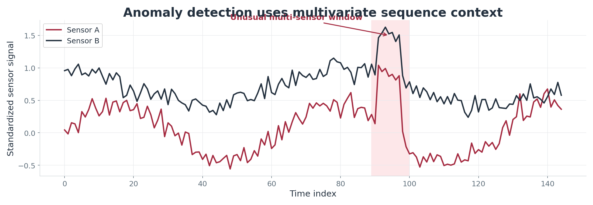{width="100%"}
:::
:::

:::::

::: {.notes}
**Instructor timing:** approximately 2 minute(s). **Section:** Sequential data.

Make clear that anomaly detection can be prediction-based, reconstruction-based, or discriminative. Today the detailed implementation is forecasting; text and anomaly detection are conceptual transfer examples.

**Expanded four-hour teaching guidance:** For forecasting, the output is often a numeric future value. For language, a sequence of tokens maps to a class, a label sequence, or another sequence. For monitoring, multiple variables over time may be mapped to a risk score. Compare the targets, losses, evaluation metrics and the operational cost of errors. These application families will recur during the demos.

**Checkpoint:** Before advancing, ask one learner to restate the central equation or diagram in their own words. If the class is unsure, repeat the numerical or graphical interpretation; use the next slide only after resolving the mismatch.

::: 

## Ordered sequences versus unordered samples

::::: {.slide-content}

::: {.columns}
::: {.column width="50%"}
**Independent sample setting**
- Rows can often be permuted without changing the statistical task.
- Model: $\hat y_i=f(\mathbf x_i)$.
- No explicit state between rows.
:::
::: {.column width="50%"}
**Sequential setting**
- Order and gaps between measurements matter.
- Model: $\mathbf h_t=F(\mathbf x_t,\mathbf h_{t-1})$.
- Historical state influences the output.
:::
:::
::: {.question}
Does permuting timestamps leave a one-day-ahead forecasting problem unchanged?
:::

:::::

::: {.notes}
**Instructor timing:** approximately 4 minute(s). **Section:** Extended four-hour lecture.

Timing: 4 minutes. Show the distinction between exchangeability assumptions in an ordinary supervised learning table and conditional temporal dependence in sequences. Explain that some static problems have order only as an arbitrary row label; a stock-price time series does not. Draw a two-column table with values 10, 12, 9 and reverse the order. A statistic such as the mean is unchanged, but the next-step prediction problem changes. Not all chronological patterns are causal: seasonality and common trends may induce correlations without a direct intervention relationship. Invite an example from econometrics, NLP or sensors.

**Discussion prompt:** Ask students to justify one assumption, interpretation, or step on this slide; confirm that they can distinguish an illustrative example from a measured experimental result.
:::

## Formal notation for sequential learning

::::: {.slide-content}

For sequence $i$, let $X^{(i)}=(\mathbf x_1,\ldots,\mathbf x_{T_i})$ where $\mathbf x_t\in\mathbb R^F$.

$$\mathbf h_0=\mathbf 0,\qquad \mathbf h_t=F_\theta(\mathbf x_t,\mathbf h_{t-1}).$$

| Symbol | Meaning |
|:--|:--|
| $T_i$ | Timesteps (possibly variable) |
| $F$ | Input features per timestep |
| $H$ | Hidden-state dimension |
| $\theta$ | Shared trainable parameters |

::: {.takeaway}
The recurrence is indexed by **time**, not by independent observations.
:::

:::::

::: {.notes}
**Instructor timing:** approximately 4 minute(s). **Section:** Extended four-hour lecture.

Timing: 4 minutes. Write sequence superscript i to indicate training cases and subscript t for time. Clarify that features within a timestep are simultaneous components. Different sequences may have different T_i, but the same recurrent function can be applied repeatedly. A hidden-state dimension H is a design choice, not equal to F necessarily. Explain initial states: a zero initial state is conventional, though some applications learn or carry state across windows. The recurrence alone does not specify the predictive head or loss; both depend on the task. Check student understanding by asking whether there are N independent hidden-state chains or a single one for the entire dataset.

**Discussion prompt:** Ask students to justify one assumption, interpretation, or step on this slide; confirm that they can distinguish an illustrative example from a measured experimental result.
:::

## Causal forecasting and bidirectional encoding

::::: {.slide-content}

::: {.columns}
::: {.column width="50%"}
**Forecasting at time $t$**
$$\hat y_{t+1}=g(\mathbf x_{\le t})$$
Future inputs are unavailable at prediction time.
:::
::: {.column width="50%"}
**Labeling an already observed sentence**
A token label may legitimately use **left and right context** from that sentence.
:::
:::


:::::

::: {.notes}
**Instructor timing:** approximately 4 minute(s). **Section:** Extended four-hour lecture.

Timing: 4 minutes. Explain information boundaries. In next-day forecasting, a model cannot read tomorrow's observed value at forecast origin today; doing so is leakage. In part-of-speech tagging or post-hoc sequence labeling, the full sentence may already be available, allowing bidirectional processing. Distinguish bidirectional neural encoders from causal generative models. Draw a timeline and ask which observations are known at a chosen prediction time. Stress that bidirectional LSTMs are not appropriate for genuinely online forecasts if they consume future observations from the target horizon.

**Discussion prompt:** Ask students to justify one assumption, interpretation, or step on this slide; confirm that they can distinguish an illustrative example from a measured experimental result.
:::

## Why not just a feedforward network?

::::: {.slide-content}

::: {.card}
A feedforward network can learn from a **fixed-size lag window**—and may work very well.
:::

- But its input length is chosen in advance.
- A recurrent model updates a **state** at each timestep.
- The same transition function is reused as a sequence grows.

::: {.takeaway}
RNNs provide an explicit sequential inductive bias, **not a guarantee of better accuracy**.
:::

:::::

::: {.notes}
**Instructor timing:** approximately 2 minute(s). **Section:** Sequential data.

Avoid the misleading claim that feedforward networks cannot handle sequences. Explain that one can flatten 24 historical readings into a 24-dimensional vector, but recurrence processes ordered inputs with shared state-update parameters.

**Expanded four-hour teaching guidance:** A fixed-lag feedforward network is a legitimate, often strong benchmark. Its challenge is that it treats its input as a flattened fixed window and does not reuse the same state-transition mechanism at every position. An RNN implements a shared recurrence, but that inductive bias is not proof of higher accuracy. Discuss computational cost and data scarcity as reasons for preferring simpler models.

**Checkpoint:** Before advancing, ask one learner to restate the central equation or diagram in their own words. If the class is unsure, repeat the numerical or graphical interpretation; use the next slide only after resolving the mismatch.

::: 

## Sequence-to-output patterns

::::: {.slide-content}

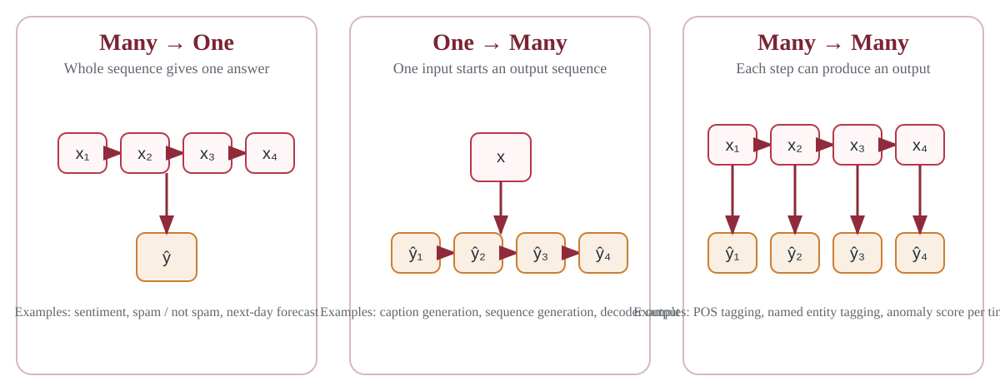{width="98%"}

::: {.takeaway}
A quick rule:

- **Many → one**: one final answer from a whole sequence.
- **One → many**: one starting input leads to a sequence of outputs.
- **Many → many**: each input step can produce its own output.
:::

:::::

::: {.notes}
**Instructor timing:** approximately 2 minute(s). **Section:** Sequential data.

Point at the corresponding outputs. Explain that many-to-one often uses a final state, and many-to-many often uses every state. One-to-many tasks typically require a decoder and cannot be fully specified by drawing only a single recurrent cell.

**Expanded four-hour teaching guidance:** Identify the mapping patterns: one sequence to one output, input sequence to output sequence, and encoder-decoder schemes with differing input/output lengths. Explain that a model can emit at every timestep or only after the last timestep. Ask students which pattern is suitable for sentiment, next-day forecasting, and part-of-speech tagging. Stress that padding or masks may be needed with unequal sequence lengths.

**Checkpoint:** Before advancing, ask one learner to restate the central equation or diagram in their own words. If the class is unsure, repeat the numerical or graphical interpretation; use the next slide only after resolving the mismatch.

::: 

## Tensor shapes: the practical foundation

::::: {.slide-content}

For batch-first recurrent layers:

$$\boxed{X\in\mathbb{R}^{N\times T\times F}}$$

| Symbol | Meaning | Example |
|:--|:--|--:|
| $N$ | batch size | 32 |
| $T$ | timesteps (lookback) | 24 |
| $F$ | features per step | 1 |


:::::

::: {.notes}
**Instructor timing:** approximately 2 minute(s). **Section:** Sequential data.

Ask students for the three numbers before revealing. Python PyTorch uses batch_first=True; Keras typically expects (batch, timesteps, features). Explain that training examples are not independent across chronological windows even when organized into batches.

**Expanded four-hour teaching guidance:** Work an example with 32 windows, 24 timesteps per window, and three feature channels. The tensor shape is (32, 24, 3). A corresponding one-step target array has shape (32,1) for scalar regression. Explain batch-first conventions in Keras3 and PyTorch when batch_first=True. Misreading dimensions produces many bugs; note that mathematical textbooks often omit the batch dimension.

**Checkpoint:** Before advancing, ask one learner to restate the central equation or diagram in their own words. If the class is unsure, repeat the numerical or graphical interpretation; use the next slide only after resolving the mismatch.

::: 

## Variable-length sequences: padding and masking

::::: {.slide-content}

::: {.columns}
::: {.column width="51%"}
Sequences may have lengths $T_1=3$, $T_2=5$.

- Pad shorter sequences to a common length.
- Provide an explicit **mask** or valid lengths.
- Exclude padding positions from sequence loss.
:::
::: {.column width="49%"}
| Sample | Step 1 | Step 2 | Step 3 | Step 4 | Step 5 |
|:--|:--|:--|:--|:--|:--|
| A | a | b | c | PAD | PAD |
| B | p | q | r | s | t |
:::
:::


:::::

::: {.notes}
**Instructor timing:** approximately 5 minute(s). **Section:** Extended four-hour lecture.

Timing: 5 minutes. Explain why batches require rectangular arrays for efficient computation. Padding adds artificial timesteps, but the model should not infer new content from them. Zero padding can be a genuine observed value and recurrent states could change when zeros are processed. In Keras there are masking facilities; in PyTorch packed sequences and lengths or explicit masks are common. For token classification, mask padded labels from the loss and metrics. Differentiate between truncating long sequences for memory constraints and padding short sequences; both are preprocessing choices with potential information consequences.

**Discussion prompt:** Ask students to justify one assumption, interpretation, or step on this slide; confirm that they can distinguish an illustrative example from a measured experimental result.
:::

## Tensor shapes: a concrete mini-batch

::::: {.slide-content}

::: {.card}
Consider **4 sequences**, **6 timesteps**, and **3 sensor channels**.
$$X\in\mathbb{R}^{4\times6\times3}$$
:::

For a one-step scalar forecast: $Y\in\mathbb{R}^{4\times1}$.

For per-timestep 5-class predictions: logits $\in\mathbb{R}^{4\times6\times5}$.

::: {.fragment .question}
**Practice:** With a batch of 32, a 12-day window and 8 variables, what is the input shape? **(32, 12, 8)**.
:::

:::::

::: {.notes}
**Instructor timing:** approximately 5 minute(s). **Section:** Extended four-hour lecture.

Timing: 5 minutes. Use the audience exercise to prevent shape errors later. Count dimensions from outermost to innermost: batches, time, features. A recurrent layer with return_sequences=True may produce (N,T,H), while the default last-state output may be (N,H). For an output head, a linear projection converts the hidden dimension to number of targets or classes. In PyTorch, batch_first=True matches this convention, but internal kernels and older examples may display time-first. Ask students to represent a 24-hour weather window with temperature, humidity, and pressure: (N,24,3).

**Discussion prompt:** Ask students to justify one assumption, interpretation, or step on this slide; confirm that they can distinguish an illustrative example from a measured experimental result.
:::

## The key idea: carry a hidden state

::::: {.slide-content}

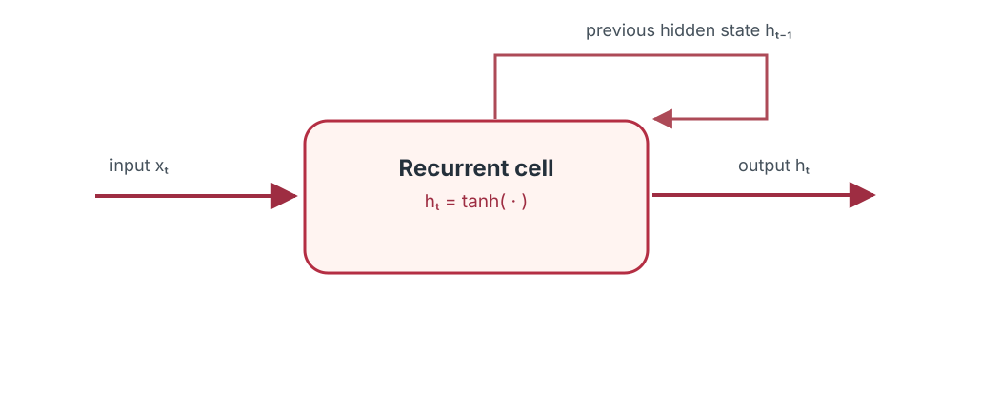{width="90%"}

At each step:

$$\boxed{\mathbf{h}_t=f(\mathbf{x}_t,\mathbf{h}_{t-1})}$$


:::::

::: {.notes}
**Instructor timing:** approximately 2 minute(s). **Section:** Sequential data.

Explain hidden state as a compressed, task-relevant summary. The state updates using the current input and previous state; information can be lost. Transition to the precise tanh update next.

**Expanded four-hour teaching guidance:** Reinterpret the hidden state as an evolving compressed representation rather than a literal copy of all prior observations. In ordinary RNNs, new inputs modify memory via a nonlinear map. The same state dimension is used at every timestep. Explain that state compression can lose information, particularly when long sequences demand fine detail from the remote past.

**Checkpoint:** Before advancing, ask one learner to restate the central equation or diagram in their own words. If the class is unsure, repeat the numerical or graphical interpretation; use the next slide only after resolving the mismatch.

::: 

## What is a vanilla RNN?

::::: {.slide-content}

::: {.columns}
::: {.column width="54%"}
- An **RNN reads one input at a time**.
- It keeps a running summary called the **hidden state**.
- At each step it combines:
  1. the **current input** $x_t$, and
  2. the **previous hidden state** $h_{t-1}$.
- The result is the **new hidden state** $h_t$.
- A prediction can be made from the hidden state.
:::
::: {.column width="46%"}
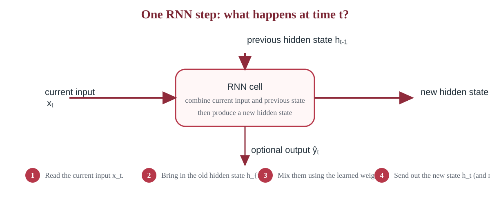{width="100%"}
:::
:::

::: {.takeaway}
Think of an RNN as a model that says: **"I saw something before, I see something now, and I update my memory."**
:::

:::::

::: {.notes}
**Instructor timing:** approximately 2 minute(s). **Section:** Vanilla RNNs.

Emphasize that unrolling is a computational diagram, not physically stacking separate independently trained networks. Different timesteps use the exact same transition parameters. Hidden state is not automatically long-term memory.

**Expanded four-hour teaching guidance:** Separate the recurrent map from the output head. For a many-to-one task, the head may read the last hidden state; for per-token labeling, it may read every hidden state. Distinguish recurrence in computation from an explicit cyclic graph during training: the computational graph is unrolled into a directed acyclic chain for a fixed sequence.

**Checkpoint:** Before advancing, ask one learner to restate the central equation or diagram in their own words. If the class is unsure, repeat the numerical or graphical interpretation; use the next slide only after resolving the mismatch.

::: 

## Inside a recurrent cell

::::: {.slide-content .has-code}

::: {.columns}
::: {.column width="47%"}
$$\mathbf{a}_t=W_{xh}\mathbf{x}_t+W_{hh}\mathbf{h}_{t-1}+\mathbf{b}_h$$

$$\mathbf{h}_t=\tanh(\mathbf{a}_t)$$

- **Step 1:** multiply the input by $W_{xh}$.
- **Step 2:** multiply the old hidden state by $W_{hh}$.
- **Step 3:** add the bias $b_h$.
- **Step 4:** apply $\tanh$ to get the new state.
:::
::: {.column width="53%"}
{width="100%"}
:::
:::


:::::

::: {.notes}
**Instructor timing:** approximately 2 minute(s). **Section:** Vanilla RNNs.

Annotate each term. Explicitly note that tanh is an activation choice for the classical vanilla RNN; other nonlinearities are possible. Weight shapes are hidden_size × input_size and hidden_size × hidden_size.

**Expanded four-hour teaching guidance:** Explain each arrow of the cell: current input, previous hidden state, linear transforms, nonlinearity, and new hidden state. Write the dimensions for scalar and vector cases. A bias shifts the preactivation, while tanh bounds each hidden coordinate between −1 and 1. Mention that different RNN implementations may use ReLU, but this lesson uses tanh for clarity.

**Checkpoint:** Before advancing, ask one learner to restate the central equation or diagram in their own words. If the class is unsure, repeat the numerical or graphical interpretation; use the next slide only after resolving the mismatch.

::: 

## Unrolling through time

::::: {.slide-content}

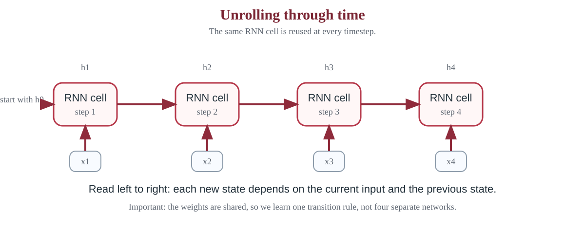{width="98%"}

::: {.fragment}
Important idea: the model **does not learn a different network at each step**.
It reuses the **same weights** again and again.
:::

:::::

::: {.notes}
**Instructor timing:** approximately 2 minute(s). **Section:** Vanilla RNNs.

Show x1 to h1, then x2 to h2, and so on. Tie to matrix multiplication and the chain rule. Explain why each backward path becomes longer with temporal distance.

**Expanded four-hour teaching guidance:** Move left to right: x1 yields h1 from h0, then x2 and h1 yield h2. Each box is not a separately trained network; its weights are reused. Ask learners to count the number of distinct recurrent parameter matrices, regardless of sequence length. Use the unfolded picture to prepare the gradient discussion.

**Checkpoint:** Before advancing, ask one learner to restate the central equation or diagram in their own words. If the class is unsure, repeat the numerical or graphical interpretation; use the next slide only after resolving the mismatch.

::: 

## RNN recurrence as a learned state machine

::::: {.slide-content}

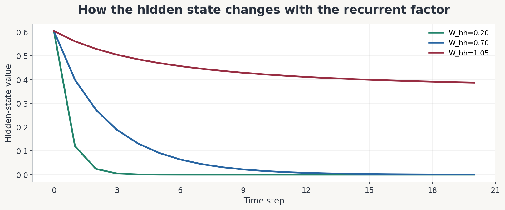{width="85%"}

::: {.small}
Illustrative scalar recurrence: $h_t=\tanh(w_hh_{t-1}+0.7x_t)$, with only $x_1=1$.
:::

:::::

::: {.notes}
**Instructor timing:** approximately 4 minute(s). **Section:** Extended four-hour lecture.

Timing: 4 minutes. Interpret the trajectory after a single impulse input. A state update can retain or lose traces of past inputs depending on recurrent weights and nonlinearity. Reusing the transition function resembles a learned state machine, but neural hidden states are continuous vectors rather than a small discrete set of states. Caution that this plot illustrates forward state dynamics, not a measured gradient or proof of long-term memory. Ask students why the hidden state does not necessarily become exactly zero after all subsequent inputs are zero.

**Discussion prompt:** Ask students to justify one assumption, interpretation, or step on this slide; confirm that they can distinguish an illustrative example from a measured experimental result.
:::

## Vanilla RNN parameter count

::::: {.slide-content}

For input dimension $F$, hidden dimension $H$ and one recurrent layer:

$$W_{xh}\in\mathbb R^{H\times F},\quad W_{hh}\in\mathbb R^{H\times H},\quad b_h\in\mathbb R^H.$$

$$\boxed{P_{\mathrm{RNN}}=HF+H^2+H=H(F+H+1)}$$

**Worked count:** $F=8$, $H=16$ gives $16(8+16+1)=\boxed{400}$ recurrent parameters.

::: {.takeaway}
Parameter count is independent of sequence length $T$.
:::

:::::

::: {.notes}
**Instructor timing:** approximately 5 minute(s). **Section:** Extended four-hour lecture.

Timing: 5 minutes. Have students count the entries of each weight matrix and bias. The input-to-hidden matrix contains H×F parameters; hidden-to-hidden contains H×H; bias contains H. Sum to H(F+H+1). For F=8,H=16 the result is 400. The dense output head has additional parameters, which should not be included in the recurrent-layer count. Compare a 10-timestep and a 100-timestep RNN: the parameters are shared, but computation and activation storage grow with timesteps. This motivates thinking separately about model complexity and sequence length.

**Discussion prompt:** Ask students to justify one assumption, interpretation, or step on this slide; confirm that they can distinguish an illustrative example from a measured experimental result.
:::

## RNN versus a fixed-window regression model

::::: {.slide-content}

::: {.columns}
::: {.column width="50%"}
**Lagged feedforward input**
$$\hat y_t=f(x_{t-1},x_{t-2},\ldots,x_{t-L})$$
- Fixed $L$ chosen in advance
- Often strong and interpretable
:::
::: {.column width="50%"}
**Recurrent state**
$$h_t=F(x_t,h_{t-1})$$
- Reuses shared transition
- Supports variable sequence length
:::
:::
::: {.question}
Can a small lagged MLP outperform an LSTM? **Yes; test it.**
:::

:::::

::: {.notes}
**Instructor timing:** approximately 4 minute(s). **Section:** Extended four-hour lecture.

Timing: 4 minutes. Present the lagged feedforward model as a legitimate baseline, not an obsolete predecessor. Discuss why a lagged MLP or gradient-boosted tree can be excellent for short patterns or limited data. An RNN compresses the history recursively; this can help and can also lose information. A fixed lag L has explicit temporal reach, whereas an RNN nominally processes long histories but can fail to exploit very old details. The choice should be driven by leak-free experiments, not algorithmic novelty.

**Discussion prompt:** Ask students to justify one assumption, interpretation, or step on this slide; confirm that they can distinguish an illustrative example from a measured experimental result.
:::

## Hidden-state equation and dimensions

::::: {.slide-content .has-code}

$$\boxed{\mathbf{h}_t=\tanh(W_{xh}\mathbf{x}_t+W_{hh}\mathbf{h}_{t-1}+\mathbf{b}_h)}$$

Let $F$ = input features and $H$ = hidden units.

$$W_{xh}\in\mathbb{R}^{H\times F},\quad W_{hh}\in\mathbb{R}^{H\times H},\quad \mathbf{b}_h\in\mathbb{R}^{H}.$$

::: {.card}
For $F=3$, $H=8$: input-to-hidden has **24** weights; hidden-to-hidden has **64** weights, excluding biases.
:::

:::::

::: {.notes}
**Instructor timing:** approximately 2 minute(s). **Section:** Vanilla RNNs.

Check shape compatibility: multiplying H×F by F×1 yields H×1, and H×H by H×1 also yields H×1. The 24 and 64 numbers are clear even before asking about total parameters.

**Expanded four-hour teaching guidance:** For input dimension d and hidden dimension h, W_xh is h-by-d, W_hh is h-by-h, and b_h is length h if vectors are columns. Warn that library tensor conventions may transpose weight matrices without changing the underlying model. Write the output equation separately so students understand a hidden state is not automatically a prediction.

**Checkpoint:** Before advancing, ask one learner to restate the central equation or diagram in their own words. If the class is unsure, repeat the numerical or graphical interpretation; use the next slide only after resolving the mismatch.

::: 

## Worked example: two RNN steps

::::: {.slide-content .has-code}

**Scalar** values: $h_0=0$, $W_{xh}=0.5$, $W_{hh}=0.4$, $b=0$; $x_1=1$, $x_2=0$.

::: {.fragment}
$$h_1=\tanh(0.5\cdot1+0.4\cdot0)=\tanh(0.5)\approx0.4621.$$
:::

::: {.fragment}
$$h_2=\tanh(0.5\cdot0+0.4\cdot0.4621)\approx0.1828.$$
:::

::: {.takeaway}
Even with $x_2=0$, the second state can carry information from $x_1$.
:::

:::::

::: {.notes}
**Instructor timing:** approximately 2 minute(s). **Section:** Vanilla RNNs.

Give students 20 seconds to calculate h1. Then reveal h2. Numerical values are rounded, so the final result is approximate. Focus on the role of the previous hidden state rather than the tanh function itself.

**Expanded four-hour teaching guidance:** Recalculate h1 with the calculator function tanh(0.5)≈0.4621. h2 depends on h1 and the zero input: tanh(0.4×0.4621)≈0.1828. Emphasize that these are explicitly chosen toy weights, not trained values. Ask how the result changes if h0 is 0.5 or if x2 becomes −1; discuss sensitivity and nonlinearity.

**Checkpoint:** Before advancing, ask one learner to restate the central equation or diagram in their own words. If the class is unsure, repeat the numerical or graphical interpretation; use the next slide only after resolving the mismatch.

::: 

## Activation saturation changes gradient flow

::::: {.slide-content}

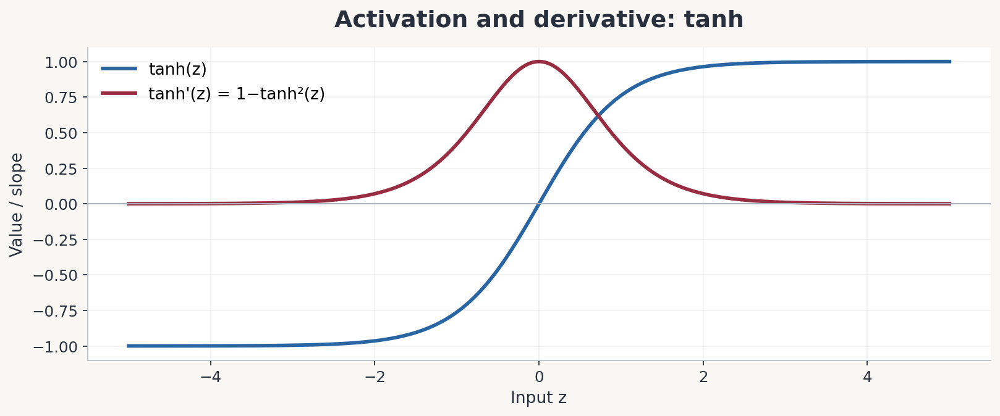{width="82%"}

$$\frac{d}{dz}\tanh z=1-\tanh^2 z\in(0,1].$$

::: {.takeaway}
For large $|z|$, tanh is nearly flat: **the local derivative becomes small**.
:::

:::::

::: {.notes}
**Instructor timing:** approximately 5 minute(s). **Section:** Extended four-hour lecture.

Timing: 5 minutes. Start with the graph of tanh and ask where it changes rapidly. Around z=0 the derivative is near one; for large positive or negative z the function saturates toward ±1 and the slope approaches zero. The slope appears in BPTT via Jacobians, so saturated units can attenuate gradients. Be precise: tanh saturation is a contributing mechanism, not the only cause of vanishing gradients. The derivative does not vanish identically for finite z, but can be so small as to impede learning. Compute tanh(0)=0 and tanh(3)≈0.995 to make the intuition concrete.

**Discussion prompt:** Ask students to justify one assumption, interpretation, or step on this slide; confirm that they can distinguish an illustrative example from a measured experimental result.
:::

## Vector-valued forward pass: dimension check

::::: {.slide-content}

Take $F=2$, $H=2$, $x_t=(1,2)^\top$, $h_{t-1}=(0.1,-0.1)^\top$.

$$W_{xh}=\begin{bmatrix}.2&.1\\-.1&.3\end{bmatrix},\quad W_{hh}=\begin{bmatrix}.5&0\\0&.5\end{bmatrix}.$$

$$z_t=W_{xh}x_t+W_{hh}h_{t-1} =\begin{bmatrix}.45\\ .45\end{bmatrix},\quad h_t=\tanh(z_t).$$

::: {.fragment}
Hence $h_t\approx (\mathbf{0.422},\mathbf{0.422})^\top$.
:::

:::::

::: {.notes}
**Instructor timing:** approximately 6 minute(s). **Section:** Extended four-hour lecture.

Timing: 6 minutes. Compute W_xh x as (0.4,0.5). Compute W_hh hprev as (0.05,-0.05). Sum to (0.45,0.45) and apply tanh componentwise to obtain about (0.422,0.422). Ensure students know matrices multiply vectors before elementwise nonlinearity. The example uses zero bias. Ask which dimensions would break if the input vector had three features with the same matrix. This reinforces that tensor shapes are a mathematical property, not merely a programming interface.

**Discussion prompt:** Ask students to justify one assumption, interpretation, or step on this slide; confirm that they can distinguish an illustrative example from a measured experimental result.
:::

## How an RNN produces an output

::::: {.slide-content}

A hidden state is usually **not** the final prediction.

$$\hat{\mathbf{y}}_t=g(W_{hy}\mathbf{h}_t+\mathbf{b}_y)$$

- **Regression:** often $g(z)=z$.
- **Binary classification:** often $g(z)=\sigma(z)$.
- **Multiclass classification:** often softmax.

::: {.card}
**Many-to-one** forecasting: pass the last hidden state to a regression head.
:::

:::::

::: {.notes}
**Instructor timing:** approximately 2 minute(s). **Section:** Vanilla RNNs.

Discuss that output activation depends on the task and loss function, not on RNN versus LSTM. For classification with cross-entropy, some libraries take logits directly without explicit sigmoid or softmax in forward().

**Expanded four-hour teaching guidance:** The model may produce one output at the end of a window or predictions at every step. For a regression head, a linear map is common; for binary classification, sigmoid yields a probability conditional on model calibration; for multiclass tasks, softmax is common. Explain that predicting the next observation and predicting a class require different losses and metrics.

**Checkpoint:** Before advancing, ask one learner to restate the central equation or diagram in their own words. If the class is unsure, repeat the numerical or graphical interpretation; use the next slide only after resolving the mismatch.

::: 

## Why weight sharing matters

::::: {.slide-content}

::: {.columns}
::: {.column width="55%"}
- The same $W_{xh}$, $W_{hh}$, and $b_h$ act at every step.
- A learned pattern can be applied at different positions.
- Parameter count does not grow with the number of **unrolled timesteps**.
:::
::: {.column width="45%"}

:::
:::

::: {.takeaway}
Computation grows with sequence length; the core parameter count does not.
:::

:::::

::: {.notes}
**Instructor timing:** approximately 2 minute(s). **Section:** Vanilla RNNs.

Clarify the distinction between the number of repeated computational operations and number of learned weights. This is important for understanding runtime complexity and why long sequences can still be expensive.

**Expanded four-hour teaching guidance:** Parameter sharing means gradients from each timestep contribute to one recurrent weight update. This reduces parameter growth with sequence length while enabling generalization to varying lengths. But shared weights also impose a homogeneous update rule over time; add explicit calendar features if the process behaves differently across days or seasons.

**Checkpoint:** Before advancing, ask one learner to restate the central equation or diagram in their own words. If the class is unsure, repeat the numerical or graphical interpretation; use the next slide only after resolving the mismatch.

::: 

## Application: short text sentiment

::::: {.slide-content}

::: {.card}
**Input:** “The movie was surprisingly good.”
:::

1. Convert tokens to numeric embeddings.
2. Update the hidden state once per token.
3. Map the final hidden state to a **sentiment logit**.
4. Optimize classification loss on labeled examples.

::: {.question}
Would exchanging “good” and “not” potentially change the label? **Yes.**
:::

:::::

::: {.notes}
**Instructor timing:** approximately 2 minute(s). **Section:** Vanilla RNNs.

This is a conceptual demonstration rather than a trained classifier. Explain embeddings are dense vectors representing words or subwords. RNNs see token order; the model must still learn semantics from data and labels.

**Expanded four-hour teaching guidance:** Discuss tokenization and embedding lookup as steps prior to recurrence. A sentiment LSTM can read embeddings for “not”, “good”, and nearby context; whether its learned hidden representation actually captures negation depends on training. Avoid anthropomorphic claims such as “the network understands words.” Compare accuracy and F1 when classes are imbalanced.

**Checkpoint:** Before advancing, ask one learner to restate the central equation or diagram in their own words. If the class is unsure, repeat the numerical or graphical interpretation; use the next slide only after resolving the mismatch.

::: 

## Many-to-one versus per-token sequence supervision

::::: {.slide-content}

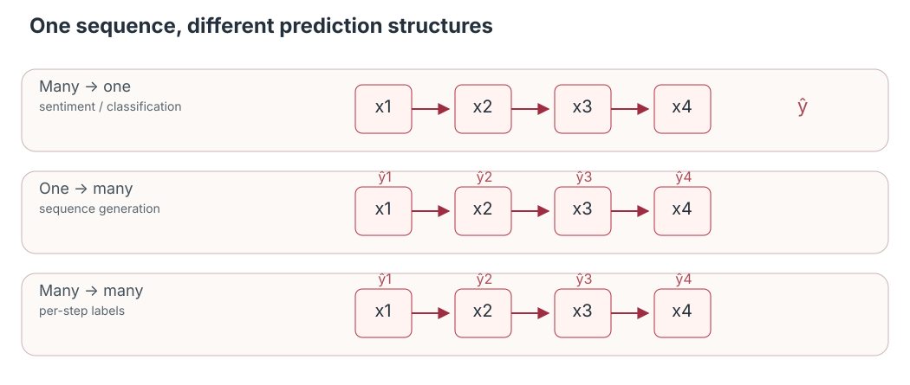{width="80%"}

- **Many-to-one:** review $\rightarrow$ sentiment label; last state may suffice.
- **Many-to-many:** words $\rightarrow$ token tags; use output at each valid step.
- **Sequence-to-sequence:** an encoder and a decoder can have different lengths.

:::::

::: {.notes}
**Instructor timing:** approximately 4 minute(s). **Section:** Extended four-hour lecture.

Timing: 4 minutes. For sentiment classification, a common network summarizes the sequence and predicts one label, so supervision arrives through the summary representation. For per-token sequence tagging, a loss may be attached to each timestep. Encoder-decoder sequence translation involves different input and output lengths, and a teacher-forcing training strategy can be used in some systems. Explain that all three tasks use ordering, yet their output heads, masks, and objectives differ. Ask which task would penalize an incorrect tag in the third word specifically.

**Discussion prompt:** Ask students to justify one assumption, interpretation, or step on this slide; confirm that they can distinguish an illustrative example from a measured experimental result.
:::

## Activity: calculate the next state

::::: {.slide-content}

::: {.question}
For $h_{t-1}=0.2$, $x_t=-1$, $W_{xh}=0.6$, $W_{hh}=0.5$, $b=0.1$:

$$h_t=\tanh(0.6x_t+0.5h_{t-1}+0.1)$$

**Compute $h_t$ and interpret its sign.** (90 seconds)
:::

::: {.fragment}
Inside $\tanh$: $-0.6+0.1+0.1=-0.4$; therefore $h_t\approx-0.3799$.
:::

:::::

::: {.notes}
**Instructor timing:** approximately 3 minute(s). **Section:** Vanilla RNNs.

Allocate about 90 seconds for students to work and 90 seconds to discuss. The negative state value is a hidden representation, not necessarily a negative forecast. Ask one person to explain where the 0.1 term from the previous state came from.

**Expanded four-hour teaching guidance:** Give students a minute to compute the hidden update before revealing the answer. Ask them to write the preactivation separately from the tanh output. Common errors: apply tanh to each weighted term independently, forget the previous state, or substitute the future observation. Encourage one peer to explain the order of operations.

**Checkpoint:** Before advancing, ask one learner to restate the central equation or diagram in their own words. If the class is unsure, repeat the numerical or graphical interpretation; use the next slide only after resolving the mismatch.

::: 

## RNN summary and its limitation

::::: {.slide-content}

::: {.columns}
::: {.column width="50%"}
**What works**

- Order-aware state updates.
- Shared weights over time.
- Flexible sequence lengths.
:::
::: {.column width="50%"}
**What is difficult**

- Long-range dependencies.
- Sequential computation.
- Unstable gradient propagation.
:::
:::

::: {.takeaway}
Question for the next section: **why can early observations have so little influence on learning?**
:::

:::::

::: {.notes}
**Instructor timing:** approximately 3 minute(s). **Section:** Vanilla RNNs.

Use this slide to consolidate and transition. State that an RNN may learn short-range patterns well, but learning some distant dependencies can be hard because optimization signals must pass through many transitions.

**Expanded four-hour teaching guidance:** Review the strengths and limitations without overclaiming. A vanilla RNN can carry useful recent context and train well on many short tasks. It may be harder to optimize for dependencies spanning many steps, but that does not imply failure on every long sequence. Link the practical memory problem to gradients, which govern learning the recurrent transition.

**Checkpoint:** Before advancing, ask one learner to restate the central equation or diagram in their own words. If the class is unsure, repeat the numerical or graphical interpretation; use the next slide only after resolving the mismatch.

::: 

## How does the network learn?

::::: {.slide-content .has-code}

For a sequence regression problem, a common objective is:

$$\mathcal{L}(\theta)=\frac1N\sum_{i=1}^N\big(\hat y_i-y_i\big)^2.$$

Parameter updates depend on:

$$\theta\leftarrow\theta-\eta\nabla_\theta\mathcal{L}.$$

::: {.card}
The gradient must account for **how an earlier hidden state influences later predictions**.
:::

:::::

::: {.notes}
**Instructor timing:** approximately 2 minute(s). **Section:** BPTT & gradients.

Define theta as all trainable parameters, eta as a learning rate, and MSE as a simple demonstration loss. Do not confuse an observation index i with sequence time index t. Loss may be summed over outputs at every timestep, depending on task.

**Expanded four-hour teaching guidance:** Clarify what is being minimized: the displayed mean squared error is a simple many-to-one example. For token tagging, sum or average losses across valid timesteps and mask padding. Gradient descent updates all shared weights; the effect of a given recurrent weight accumulates from multiple occurrences across time. Highlight the difference between loss computation and gradient propagation.

**Checkpoint:** Before advancing, ask one learner to restate the central equation or diagram in their own words. If the class is unsure, repeat the numerical or graphical interpretation; use the next slide only after resolving the mismatch.

::: 
 

## From RNN to LSTM

::::: {.slide-content}

**Long Short-Term Memory** was introduced to improve learning across long dependencies.

- Original work: Hochreiter & Schmidhuber (1997).
- Modern widely used equations include the **forget gate**, introduced later.
- An LSTM contains a **cell state** in addition to a hidden state.

::: {.takeaway}
Memory is controlled by **learned gates**, not simply carried forward unchanged.
:::

:::::

::: {.notes}
**Instructor timing:** approximately 2 minute(s). **Section:** LSTM.

Give historical context carefully: original LSTM 1997 and the learnable forget gate described by Gers et al. circa 2000. Today we teach the standard forget/input/output gated LSTM. Avoid saying LSTMs solve vanishing gradients under all conditions.

**Expanded four-hour teaching guidance:** Present LSTM as a historically important recurrent architecture developed in 1997, with common modern variants incorporating the forget gate introduced later. Name the central distinction: an explicit cell state and learned multiplicative control. Clarify that practical frameworks generally implement a modern forget-gated variant rather than exactly the original 1997 cell.

**Checkpoint:** Before advancing, ask one learner to restate the central equation or diagram in their own words. If the class is unsure, repeat the numerical or graphical interpretation; use the next slide only after resolving the mismatch.

::: 

## The modern LSTM cell

::::: {.slide-content}

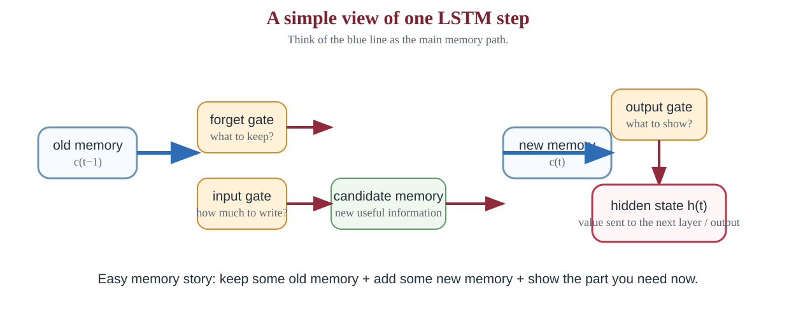{width="99%"}

::: {.small}
The blue path is the main memory line. The gates decide what to **keep**, what to **write**, and what to **show**.
:::

:::::

::: {.notes}
**Instructor timing:** approximately 2 minute(s). **Section:** LSTM.

Present the cell state as the long pathway and identify forget, input, candidate, and output transformations. The candidate is not a sigmoid gate; it is usually tanh. Note the diagram is conceptual, while the equations are authoritative.

**Expanded four-hour teaching guidance:** Follow information along the cell state path first, then identify gate operations. Explain that the candidate update uses tanh, while gates typically use sigmoid outputs between zero and one. The schematic deliberately omits some tensor-level details; the authoritative definitions appear in the equations. Reassure students they should follow one gate at a time.

**Checkpoint:** Before advancing, ask one learner to restate the central equation or diagram in their own words. If the class is unsure, repeat the numerical or graphical interpretation; use the next slide only after resolving the mismatch.

::: 

## Two states: $c_t$ versus $h_t$

::::: {.slide-content}

::: {.columns}
::: {.column width="50%"}
::: {.card}
**Cell state $\mathbf c_t$**

Carries an evolving memory representation, updated **additively** by forgetting and writing.
:::
:::
::: {.column width="50%"}
::: {.card}
**Hidden state $\mathbf h_t$**

Controls what the cell **exposes** to the next layer or the prediction head.
:::
:::
:::

$$\mathbf c_t=\mathbf f_t\odot\mathbf c_{t-1}+\mathbf i_t\odot\tilde{\mathbf c}_t$$

:::::

::: {.notes}
**Instructor timing:** approximately 2 minute(s). **Section:** LSTM.

Students often confuse the two states. Emphasize that the cell state is internal memory and the hidden state is externally exposed output, although both are passed through recurrent computation. Both are vectors with hidden_size components.

**Expanded four-hour teaching guidance:** Contrast c_t as internal persistent memory with h_t as the exposed state used for outputs and the next gate computations. They have the same vector length in a standard LSTM, but different computational meanings. Do not describe either as a perfect record of all inputs. Ask which of the two is directly exposed through the output gate.

**Checkpoint:** Before advancing, ask one learner to restate the central equation or diagram in their own words. If the class is unsure, repeat the numerical or graphical interpretation; use the next slide only after resolving the mismatch.

::: 

## LSTM history: original cell and later forget gate

::::: {.slide-content}

| Contribution | Date | Core idea |
|:--|:--|:--|
| Hochreiter & Schmidhuber | 1997 | Long Short-Term Memory architecture |
| Gers, Schmidhuber & Cummins | 2000 | Adaptive forget gate |
| Current common implementations | Later | Forget, input, candidate, and output transforms |

::: {.takeaway}
The six standard equations shown in this lecture describe a **modern forget-gated LSTM**.
:::

:::::

::: {.notes}
**Instructor timing:** approximately 4 minute(s). **Section:** Extended four-hour lecture.

Timing: 4 minutes. Correct a common historical simplification. The foundational 1997 LSTM architecture introduced the key memory concept, but the adaptive forget gate developed in later work is part of the modern textbook and software version. Explain that historical accuracy matters when presenting citations, even though most introductory courses use a standard modern formula. Students do not need to learn every LSTM variant for this lecture. Distinguish the computational concept of retaining state from the specific set of current trainable gates.

**Discussion prompt:** Ask students to justify one assumption, interpretation, or step on this slide; confirm that they can distinguish an illustrative example from a measured experimental result.
:::

## What is a gate?

::::: {.slide-content}

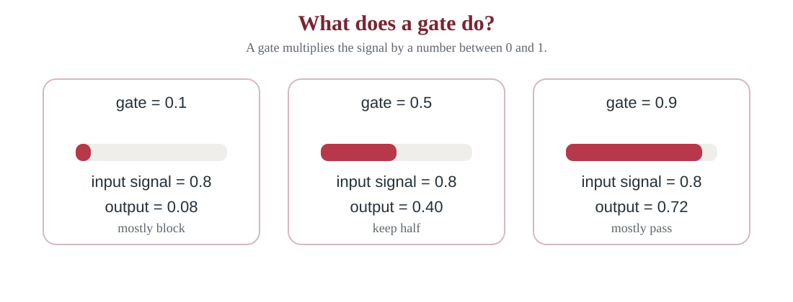{width="96%"}

$$\sigma(z)=\frac{1}{1+e^{-z}}\in(0,1)$$

::: {.takeaway}
A gate is not an all-or-nothing switch. It usually acts like a **dimmer knob**:
small value = block more, large value = pass more.
:::

:::::

::: {.notes}
**Instructor timing:** approximately 2 minute(s). **Section:** LSTM.

Point out elementwise sigmoid, not a binary hard switch. A gate can take intermediate values. Demonstrate 0.8 times 0.4 gives 0.32. The gate values emerge from a learned affine transform of current input and previous hidden state.

**Expanded four-hour teaching guidance:** The sigmoid gate is not a binary switch during ordinary continuous training; its coordinates are real numbers between zero and one. Multiplication is elementwise, so a gate can attenuate different memory dimensions differently. At z=0 sigmoid=0.5; at z=3 it is close to 0.95. A gate can saturate, which can itself slow training.

**Checkpoint:** Before advancing, ask one learner to restate the central equation or diagram in their own words. If the class is unsure, repeat the numerical or graphical interpretation; use the next slide only after resolving the mismatch.

::: 

## Forget gate: what to retain?

::::: {.slide-content .has-code}

$$\boxed{\mathbf f_t=\sigma(W_f[\mathbf h_{t-1},\mathbf x_t]+\mathbf b_f)}$$

The retained previous memory is:

$$\mathbf f_t\odot\mathbf c_{t-1}$$

::: {.fragment}
If $c_{t-1}=0.8$ and $f_t=0.25$, retained contribution is **0.20**.
:::

::: {.takeaway}
The forget gate controls the **old** component of memory.
:::

:::::

::: {.notes}
**Instructor timing:** approximately 2 minute(s). **Section:** LSTM.

Explain concatenation notation, which is a convenient presentation equivalent to separate linear transformations of h and x. Emphasize the scalar example is one component of a vector memory.

**Expanded four-hour teaching guidance:** Use the forget equation to explain that the model chooses what fraction of old cell memory to preserve along each coordinate. The gate depends on input and preceding hidden state. A value of 0.8 in one dimension retains 80% of that coordinate before any write term is added. The historical forget gate is a later extension to the original 1997 LSTM design.

**Checkpoint:** Before advancing, ask one learner to restate the central equation or diagram in their own words. If the class is unsure, repeat the numerical or graphical interpretation; use the next slide only after resolving the mismatch.

::: 

## Input gate: what to write?

::::: {.slide-content}

$$\boxed{\mathbf i_t=\sigma(W_i[\mathbf h_{t-1},\mathbf x_t]+\mathbf b_i)}$$

- High $i_t$: permit a stronger **new-information** contribution.
- Low $i_t$: reduce the candidate's influence.
- The gate is learned from both current input and previous hidden state.

::: {.question}
If $i_t=0$, can the candidate change the cell state at this step? **No**, not through the input term.
:::

:::::

::: {.notes}
**Instructor timing:** approximately 2 minute(s). **Section:** LSTM.

Distinguish input gate from input x_t; the gate is a learned controller that decides how much candidate content can enter memory. Cell state may still change via forgetting.

**Expanded four-hour teaching guidance:** The input gate decides how much proposed memory may enter the cell. It does not choose the candidate values itself; the candidate transformation separately determines a signed update. Compare input gate zero versus one and stress that actual gates can take intermediate values.

**Checkpoint:** Before advancing, ask one learner to restate the central equation or diagram in their own words. If the class is unsure, repeat the numerical or graphical interpretation; use the next slide only after resolving the mismatch.

::: 

## Candidate memory: what to propose?

::::: {.slide-content}

$$\boxed{\tilde{\mathbf c}_t=\tanh(W_c[\mathbf h_{t-1},\mathbf x_t]+\mathbf b_c)}$$

- Candidate values lie between **−1 and 1**.
- Unlike the sigmoid gate, the candidate can be **positive or negative**.
- The actual contribution is $\mathbf i_t\odot\tilde{\mathbf c}_t$.

::: {.card}
**Gate × candidate** = controlled new information.
:::

:::::

::: {.notes}
**Instructor timing:** approximately 2 minute(s). **Section:** LSTM.

Students should learn that the candidate is not an extra independent memory or a sigmoid gate. It proposes values that the input gate scales. Mention that activation conventions can vary among implementation variants.

**Expanded four-hour teaching guidance:** The candidate vector is usually tanh-transformed and may be negative. New information can increase or decrease a cell coordinate depending on the product with input gate. Do not confuse candidate input with the gate: one proposes content and the other scales its acceptance.

**Checkpoint:** Before advancing, ask one learner to restate the central equation or diagram in their own words. If the class is unsure, repeat the numerical or graphical interpretation; use the next slide only after resolving the mismatch.

::: 

## Gate activations: interpretation by dimension

::::: {.slide-content}

::: {.columns}
::: {.column width="55%"}
| Cell dimension | Forget $f$ | Input $i$ | Output $o$ |
|:--|--:|--:|--:|
| 1 | 0.95 | 0.05 | 0.80 |
| 2 | 0.10 | 0.90 | 0.40 |
| 3 | 0.65 | 0.20 | 0.05 |
:::
::: {.column width="45%"}
::: {.question}
Which dimension mostly **retains** old memory? Which mostly **writes** new content? Which is largely **hidden** from output?
:::
:::
:::

::: {.small}
Values are pedagogical examples, not measured gate activations.
:::

:::::

::: {.notes}
**Instructor timing:** approximately 5 minute(s). **Section:** Extended four-hour lecture.

Timing: 5 minutes. Explain that each gate is a vector rather than one global switch. Read the three coordinate rows: dimension 1 mostly preserves memory; dimension 2 is ready to overwrite; dimension 3 has a near-zero output gate and is mostly concealed from h_t even though c_t can be nonzero. These interpretations are local to the given values and do not automatically identify a semantic meaning such as “negation detector.” Ask learners to calculate qualitatively what happens if the old cell value is positive and candidate value negative in dimension 2. Emphasize that gates are input-dependent and can change at every timestep.

**Discussion prompt:** Ask students to justify one assumption, interpretation, or step on this slide; confirm that they can distinguish an illustrative example from a measured experimental result.
:::


:::

## Cell-state update: retain + write

::::: {.slide-content}

$$\boxed{\mathbf c_t=\mathbf f_t\odot\mathbf c_{t-1}+\mathbf i_t\odot\tilde{\mathbf c}_t}$$

::: {.fragment}
**Retain:** $f_t\odot c_{t-1}$  
**Write:** $i_t\odot\tilde c_t$
:::

::: {.takeaway}
The **additive** path is a central reason LSTM can propagate some gradients more effectively than a conventional RNN.
:::

:::::

::: {.notes}
**Instructor timing:** approximately 2 minute(s). **Section:** LSTM.

Use a physical notebook analogy if needed, but return to the actual equation. The cell state is not bounded to [0,1]; it can exceed 1 or become negative because the update is additive.

**Expanded four-hour teaching guidance:** Write both contributions distinctly: retained history f⊙c_previous and new content i⊙candidate. The sum gives c_t. Explain why an additive route can mitigate some gradient attenuation relative to repeatedly squashing a single hidden vector, while not guaranteeing unrestricted gradient flow.

**Checkpoint:** Before advancing, ask one learner to restate the central equation or diagram in their own words. If the class is unsure, repeat the numerical or graphical interpretation; use the next slide only after resolving the mismatch.

::: 

## Output gate: what to reveal?

::::: {.slide-content .has-code}

$$\boxed{\mathbf o_t=\sigma(W_o[\mathbf h_{t-1},\mathbf x_t]+\mathbf b_o)}$$

The output gate controls the **visible hidden state**, rather than directly overwriting cell memory.

::: {.fragment}
$$\mathbf h_t=\mathbf o_t\odot\tanh(\mathbf c_t)$$
:::

::: {.question}
If $o_t\approx0$, is the cell state necessarily erased? **No.**
:::

:::::

::: {.notes}
**Instructor timing:** approximately 2 minute(s). **Section:** LSTM.

A low output gate can conceal information from the exposed hidden state while maintaining it in cell state. Explain that the tanh maps cell-state values into a bounded range before output gating.

**Expanded four-hour teaching guidance:** The output gate modulates what portion of tanh(c_t) becomes visible as h_t. It does not directly erase the internal memory; it controls its exposure to the downstream output head and future gate calculations. Ask whether an output gate near zero forces cell state to zero. It does not.

**Checkpoint:** Before advancing, ask one learner to restate the central equation or diagram in their own words. If the class is unsure, repeat the numerical or graphical interpretation; use the next slide only after resolving the mismatch.

::: 

## Hidden-state calculation

::::: {.slide-content}

**Example:** $c_t=0.62$ and $o_t=0.7$.

$$h_t=0.7\,\tanh(0.62)\approx0.3858.$$

::: {.fragment}
The same cell state can produce different hidden states depending on the output gate.
:::

::: {.card}
**Many-to-one forecasting:** a dense layer maps the final $h_T$ to $\hat y$.
:::

:::::

::: {.notes}
**Instructor timing:** approximately 2 minute(s). **Section:** LSTM.

Demonstrate that tanh(0.62) is about 0.551, giving h about 0.386. The output gate gates the exposure of current cell state to the next layer or output head.

**Expanded four-hour teaching guidance:** The exposed hidden state h_t may differ significantly from c_t because tanh and the output gate modify it. A standard LSTM supplies both h and c as recurrent state values into the next step. Review why a task can map h_t to a forecast while internal memory persists independently.

**Checkpoint:** Before advancing, ask one learner to restate the central equation or diagram in their own words. If the class is unsure, repeat the numerical or graphical interpretation; use the next slide only after resolving the mismatch.

::: 

## Output-gate saturation and its derivative

::::: {.slide-content}

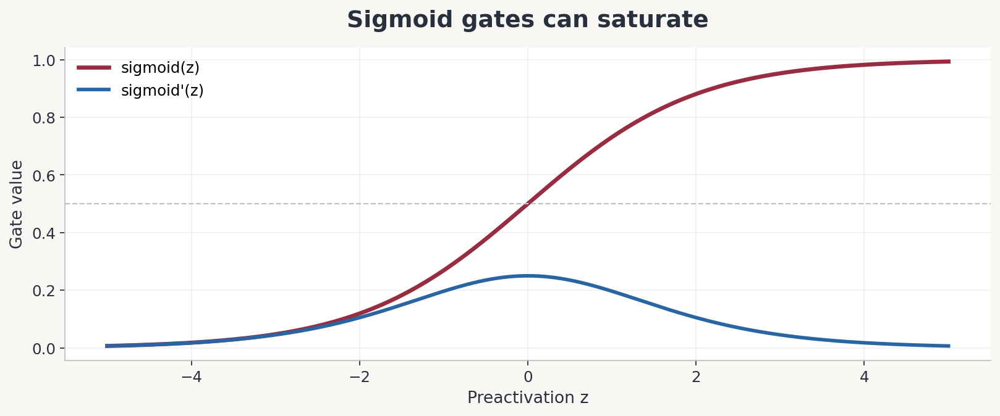{width="83%"}

$$\sigma(z)=\frac1{1+e^{-z}},\qquad\sigma'(z)=\sigma(z)(1-\sigma(z)).$$

::: {.takeaway}
Gates help control information flow, but **saturated gates can also have small gradients**.
:::

:::::

::: {.notes}
**Instructor timing:** approximately 4 minute(s). **Section:** Extended four-hour lecture.

Timing: 4 minutes. Explain sigmoid is nearly linear only in a narrow central region and saturates close to zero or one in the tails. Its derivative peaks at 0.25 when the gate output is 0.5. This does not mean a forget gate near one is undesirable; it can support memory retention. But adjustments to a saturated gate may learn slowly. Differentiate the derivative of cell state with respect to previous cell state along the direct path from the derivative of the gate value with respect to its parameters. These are related but not identical mechanisms.

**Discussion prompt:** Ask students to justify one assumption, interpretation, or step on this slide; confirm that they can distinguish an illustrative example from a measured experimental result.
:::

## What does gating cost in parameters?

::::: {.slide-content}

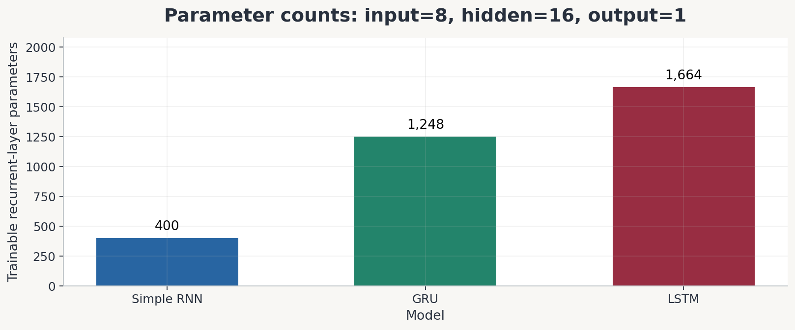{width="84%"}

$$P_{\mathrm{LSTM}}=4H(F+H+2)$$
for the common PyTorch gate implementation with **two bias vectors**.

::: {.small}
With $F=8,H=16$: Simple RNN = 400, GRU = 1,248, LSTM = 1,664 recurrent-layer parameters. Counts depend on library bias conventions.
:::

:::::

::: {.notes}
**Instructor timing:** approximately 5 minute(s). **Section:** Extended four-hour lecture.

Timing: 5 minutes. Explain that an LSTM needs four affine transformations for forget, input, candidate and output. In PyTorch, each gate has separate input-hidden and hidden-hidden biases, hence 4×[HF+H²+2H]. For F=8,H=16 this is 1664. Some Keras-style implementations use one bias vector per gate and count fewer biases; therefore these numbers are not universal across every framework. The chart intentionally uses a documented parameter-count convention. Note that all three models would also need an output head, omitted here, and more parameters can overfit on scarce data.

**Discussion prompt:** Ask students to justify one assumption, interpretation, or step on this slide; confirm that they can distinguish an illustrative example from a measured experimental result.
:::

## All LSTM equations on one slide

::::: {.slide-content}

::: {.small}
$$\begin{aligned}
\mathbf f_t&=\sigma(W_f[\mathbf h_{t-1},\mathbf x_t]+\mathbf b_f)\\
\mathbf i_t&=\sigma(W_i[\mathbf h_{t-1},\mathbf x_t]+\mathbf b_i)\\
\tilde{\mathbf c}_t&=\tanh(W_c[\mathbf h_{t-1},\mathbf x_t]+\mathbf b_c)\\
\mathbf c_t&=\mathbf f_t\odot\mathbf c_{t-1}+\mathbf i_t\odot\tilde{\mathbf c}_t\\
\mathbf o_t&=\sigma(W_o[\mathbf h_{t-1},\mathbf x_t]+\mathbf b_o)\\
\mathbf h_t&=\mathbf o_t\odot\tanh(\mathbf c_t)
\end{aligned}$$
:::

::: {.takeaway}
**Forget → propose/write → update cell → expose hidden.**
:::

:::::

::: {.notes}
**Instructor timing:** approximately 2 minute(s). **Section:** LSTM.

Identify each symbol one more time. Explain W matrices include a concatenation of hidden and input transformations, and ⊙ means elementwise multiplication. This is the modern no-peephole pedagogical variant.

**Expanded four-hour teaching guidance:** Read equations in the order forget, input, candidate, cell update, output, and hidden state. Ask students to mark shared inputs h_previous and x_t. Explain that each gate has its own matrix and bias, and that implementations may fuse these operations for speed. Dimensions are usually h for each gate and the hidden/cell states.

**Checkpoint:** Before advancing, ask one learner to restate the central equation or diagram in their own words. If the class is unsure, repeat the numerical or graphical interpretation; use the next slide only after resolving the mismatch.

::: 

## Worked example: one complete LSTM step

::::: {.slide-content .has-code}

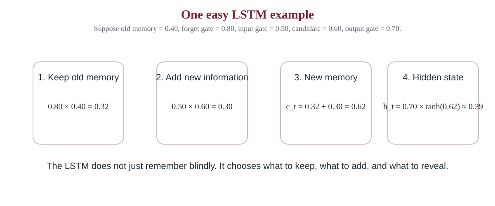{width="98%"}

::: {.takeaway}
In a real model, these gate values are **learned automatically** from the current input and the previous hidden state.
:::

:::::

::: {.notes}
**Instructor timing:** approximately 2 minute(s). **Section:** LSTM.

Ask students to separate the two memory contributions before doing the final addition. Be explicit that values of f,i,o have been provided for this arithmetic exercise rather than derived from gate matrices.

**Expanded four-hour teaching guidance:** Check arithmetic carefully: retained term is 0.8×0.4=0.32; new term is 0.5×0.6=0.30; cell is 0.62. Compute tanh(0.62)≈0.5511, then multiply by 0.7 to obtain ~0.3858. These gate values are supplied, not learned on the board. Ask what would change if o=0.

**Checkpoint:** Before advancing, ask one learner to restate the central equation or diagram in their own words. If the class is unsure, repeat the numerical or graphical interpretation; use the next slide only after resolving the mismatch.

::: 

## Why LSTM can help gradients

::::: {.slide-content}

Holding the **gate values fixed** locally, the cell-state update includes:

$$\frac{\partial\mathbf c_t}{\partial\mathbf c_{t-1}}\approx\mathrm{diag}(\mathbf f_t).$$

- If a forget component is near **1**, it can preserve a gradient pathway.
- The state update has an **additive branch**, reducing reliance on repeated saturated nonlinear transformations.
- Full derivatives include dependence of the gates on the previous state.

::: {.takeaway}
**Improved gradient pathways—not a mathematical guarantee against vanishing gradients.**
:::

:::::

::: {.notes}
**Instructor timing:** approximately 2 minute(s). **Section:** LSTM.

The approximation deliberately treats gate values as locally fixed; in the full network gates depend on h and therefore indirectly on past cell state. Avoid an overconfident claim that gradients never vanish. Discuss saturation and gate choices.

**Expanded four-hour teaching guidance:** For the direct path through c_t, holding gate values fixed, the local derivative with respect to c_previous is diag(f_t). The complete derivative additionally includes indirect routes through gate dependencies. Discuss how f values near one support a path for gradient flow but do not prove all long-range gradients survive; the task, optimizer, and gates still matter.

**Checkpoint:** Before advancing, ask one learner to restate the central equation or diagram in their own words. If the class is unsure, repeat the numerical or graphical interpretation; use the next slide only after resolving the mismatch.

::: 

## Direct cell-state gradient versus full derivative


:::

## What LSTMs do not automatically solve

::::: {.slide-content}

- **Long sequences:** training still requires sequential recurrence and computational memory.
- **Data shift:** a changing process can invalidate a learned forecast.
- **Weak baselines:** added complexity does not ensure better test error.
- **Interpretability:** gate values are not self-evident causal explanations.
- **Temporal leakage:** architecture does not repair an invalid split.

::: {.takeaway}
An LSTM is an architectural tool, not a guarantee of long-range understanding.
:::

:::::

::: {.notes}
**Instructor timing:** approximately 4 minute(s). **Section:** Extended four-hour lecture.

Timing: 4 minutes. Give one counterexample per bullet: high-frequency inputs can still strain memory and compute; concept drift causes forecasts to degrade; a seasonal naive baseline can outperform a tuned LSTM; a forget gate close to one is not automatically an interpretable physical retention mechanism; random overlapping train/test windows can inflate performance. Ask students to name one validation action that addresses each issue. Encourage attention to whether the dataset is large enough to estimate a high-parameter recurrent model responsibly.

**Discussion prompt:** Ask students to justify one assumption, interpretation, or step on this slide; confirm that they can distinguish an illustrative example from a measured experimental result.
:::


:::

## Practical case study: forecast one step

::::: {.slide-content}

**Goal:** predict $y_t$ from the previous **24** values.

$$\underbrace{(y_{t-24},\ldots,y_{t-1})}_{\text{model input}}\longrightarrow\hat y_t$$

::: {.card}
We use a **synthetic, reproducible** 500-observation series with trend, periodic structure, and noise.
:::

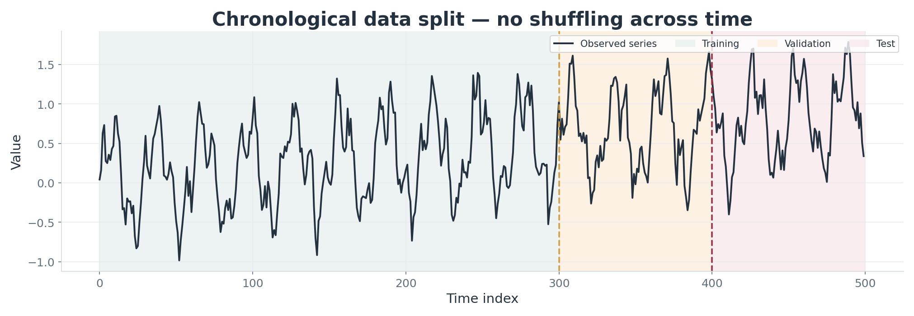{width="93%"}

:::::

::: {.notes}
**Instructor timing:** approximately 2 minute(s). **Section:** Implementation.

Explain the synthetic data is not a real-world empirical benchmark. The experiment uses one-step forecasting, 24 lookback timesteps, and one numeric target. More complex tasks can be added after students understand this pipeline.

**Expanded four-hour teaching guidance:** Set up a supervised one-step-ahead forecasting experiment with input window of length 24 and scalar target. Define the forecast origin explicitly. The synthetic data illustrate trend, seasonality, and noise, but results cannot be generalized to financial or biomedical series without further evidence. Emphasize matching algorithms to the same forecast horizon.

**Checkpoint:** Before advancing, ask one learner to restate the central equation or diagram in their own words. If the class is unsure, repeat the numerical or graphical interpretation; use the next slide only after resolving the mismatch.

::: 

## Chronological split and leakage

::::: {.slide-content}

{width="91%"}

- First **300** observations: training.
- Next **100**: validation / early stopping.
- Last **100**: untouched test targets.
- Estimate the **normalization mean and SD on training observations only**.

::: {.takeaway}
At each prediction time, inputs come only from **earlier** observations.
:::

:::::

::: {.notes}
**Instructor timing:** approximately 2 minute(s). **Section:** Implementation.

Clarify that validation and test windows can include historical observations from the previous partition, but never future target values. The model is evaluated on targets in each chronological partition. Random splitting of overlapping windows would leak information and inflate test performance.

**Expanded four-hour teaching guidance:** A chronological split follows causality: earlier observations train, later observations validate, latest observations test. Fit normalization parameters only on the training period. It is acceptable for a validation input window to include earlier training observations because they would have been known at prediction time. Do not let its target leak into fitting or selection.

**Checkpoint:** Before advancing, ask one learner to restate the central equation or diagram in their own words. If the class is unsure, repeat the numerical or graphical interpretation; use the next slide only after resolving the mismatch.

::: 


:::

## Rolling-origin validation

::::: {.slide-content}

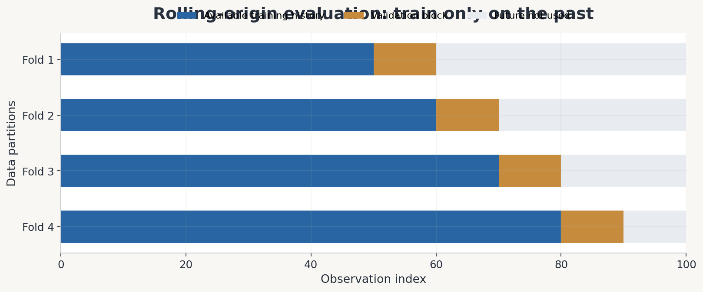{width="82%"}

- Each validation fold is later than its training history.
- Parameters and scalers are refitted within each fold where appropriate.
- Compare performance across different regimes and dates.

::: {.small}
Illustrative evaluation folds. No test performance is inferred from the diagram.
:::

:::::

::: {.notes}
**Instructor timing:** approximately 5 minute(s). **Section:** Extended four-hour lecture.

Timing: 5 minutes. Explain an expanding-window rolling-origin design. In fold one, train up to time 50 and validate on 51–60; in fold two train up to 60 and validate on 61–70, and so on. This estimates how the procedure generalizes across successive forecast origins. Each fold's scaler must use only the corresponding training history. For models with hyperparameter tuning, separate tuning from the final untouched test period. Discuss the computational cost of repeated neural-network refits and why a simpler single validation split may be acceptable for classroom demonstration, but a publication needs stronger evidence.

**Discussion prompt:** Ask students to justify one assumption, interpretation, or step on this slide; confirm that they can distinguish an illustrative example from a measured experimental result.
:::

## Creating sliding windows

::::: {.slide-content}

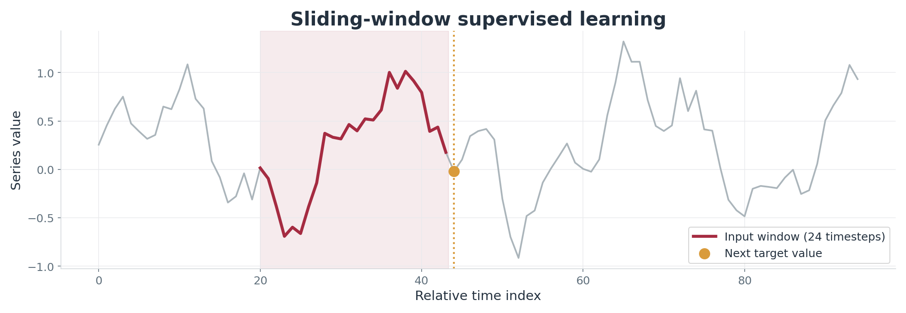{width="94%"}

$$X_i=[z_i,\ldots,z_{i+23}]\in\mathbb{R}^{24\times1},\quad y_i=z_{i+24}.$$

::: {.card}
The complete batch tensor has shape **(number of windows, 24, 1)**.
:::

:::::

::: {.notes}
**Instructor timing:** approximately 2 minute(s). **Section:** Implementation.

Explain z denotes scaled observations. A new sample is produced by sliding the window forward one time step. Overlapping input windows are acceptable because they are part of a time-series learning problem; do not randomly split them into train and test.

**Expanded four-hour teaching guidance:** Work with one window: twenty-four known observations predict the twenty-fifth. Label the X and y arrays and verify the first and last target indices. Discuss overlapping windows: overlap does not automatically imply leakage, but random splitting of overlapping windows can place almost identical information in train and test. Prefer splitting by target time.

**Checkpoint:** Before advancing, ask one learner to restate the central equation or diagram in their own words. If the class is unsure, repeat the numerical or graphical interpretation; use the next slide only after resolving the mismatch.

::: 

## Always include a baseline

::::: {.slide-content .has-code}

For one-step forecasting, the **persistence** baseline is:

$$\hat y_t^{\mathrm{naive}}=y_{t-1}.$$

The test-set root mean squared error is:

$$\mathrm{RMSE}=\sqrt{\frac1{n_{test}}\sum_{t\in\mathrm{test}}(\hat y_t-y_t)^2}.$$

::: {.takeaway}
A complex model should be compared against a relevant simple forecast.
:::

:::::

::: {.notes}
**Instructor timing:** approximately 2 minute(s). **Section:** Implementation.

Explain why persistence is strong for smooth, highly autocorrelated sequences. RMSE uses original measurement units after inverse scaling. One-step test evaluation here uses the last observed target value in each input window, not recursive forecasts.

**Expanded four-hour teaching guidance:** The naive baseline predicts the last observed value as the next value. It can be highly competitive when autocorrelation is strong. Evaluate all models on the same test set with RMSE in original units; consider MAE for robustness. Avoid tuning on the test set. A strong result requires improving on task-relevant baselines, not merely lowering training loss.

**Checkpoint:** Before advancing, ask one learner to restate the central equation or diagram in their own words. If the class is unsure, repeat the numerical or graphical interpretation; use the next slide only after resolving the mismatch.

::: 

## Fair forecasting baselines: a ladder

::::: {.slide-content}

1. **Persistence:** predict the last observation.
2. **Seasonal naive:** predict the observation from one seasonal period ago.
3. **Linear / ridge regression** on predefined lagged features.
4. **Simple RNN**, then **LSTM**, under matched evaluation.

$$\mathrm{Skill}=1-\frac{\mathrm{RMSE}_{\mathrm{model}}}{\mathrm{RMSE}_{\mathrm{baseline}}}$$

::: {.small}
Positive skill indicates improvement relative to the chosen baseline (a defined ratio, not a universal metric).
:::

:::::

::: {.notes}
**Instructor timing:** approximately 5 minute(s). **Section:** Extended four-hour lecture.

Timing: 5 minutes. Explain why a one-step persistence baseline alone is not adequate if data have strong daily or weekly seasonality. Add a seasonal naive predictor and a lagged linear model as stronger tests. Every method must predict the same target indices and use the same information set. The displayed skill ratio is a convenient custom comparison: zero means tie, positive indicates lower RMSE, negative higher RMSE. Explain that this formulation differs from some domain-specific skill scores, so the definition must accompany any report. Ask whether a neural model with impressive training fit but worse test skill is ready for deployment. No.

**Discussion prompt:** Ask students to justify one assumption, interpretation, or step on this slide; confirm that they can distinguish an illustrative example from a measured experimental result.
:::

## R implementation: vanilla RNN

::::: {.slide-content .has-code}

```{.r}
library(keras3)
model <- keras_model_sequential() |>
  layer_simple_rnn(units = 16,
                   input_shape = c(24, 1),
                   activation = "tanh") |>
  layer_dense(units = 1)
model |> compile(
  optimizer = optimizer_adam(0.01),
  loss = "mse"
)
```

::: {.small}
Full runnable script: `R/train_models.R` · Keras3/TensorFlow backend.
:::

:::::

::: {.notes}
**Instructor timing:** approximately 2 minute(s). **Section:** Implementation.

Walk through units=16, input shape excluding batch, last hidden state becoming dense output, regression head, and MSE. Explain that backend must be installed first and that the complete script handles preprocessing, train/validation/test, and evaluation.

**Expanded four-hour teaching guidance:** In Keras3, a model with SimpleRNN(units=16) produces a final hidden vector by default unless return_sequences is set to TRUE. The Dense(1) head maps the vector to a scalar forecast. Show why input_shape=(24,1) is a sequence shape independent of batch count. Keras3 with TensorFlow backend requires a working Python environment.

**Checkpoint:** Before advancing, ask one learner to restate the central equation or diagram in their own words. If the class is unsure, repeat the numerical or graphical interpretation; use the next slide only after resolving the mismatch.

::: 

## R implementation: replace RNN with LSTM

::::: {.slide-content .has-code}

```{.r}
model <- keras_model_sequential() |>
  layer_lstm(units = 16,
             input_shape = c(24, 1)) |>
  layer_dense(units = 1)
model |> compile(
  optimizer = optimizer_adam(0.01),
  loss = "mse"
)
```

::: {.takeaway}
The **data pipeline and evaluation protocol stay the same**; only the recurrent layer changes.
:::

:::::

::: {.notes}
**Instructor timing:** approximately 2 minute(s). **Section:** Implementation.

Students see how similar the high-level APIs are. Clarify that the number of trainable parameters changes because LSTM internally includes four affine transformations for gates and candidate.

**Expanded four-hour teaching guidance:** Change only the recurrent layer to LSTM for the controlled illustration. Equal hidden size does not imply equal parameter count or training time: LSTM has four affine transformations per timestep. Ask how to compare models fairly: same data, horizon, split, preprocessing, and tuning budget; report resource costs alongside accuracy.

**Checkpoint:** Before advancing, ask one learner to restate the central equation or diagram in their own words. If the class is unsure, repeat the numerical or graphical interpretation; use the next slide only after resolving the mismatch.

::: 

## Keras3 in R: tensor and output shapes

::::: {.slide-content}

```{.r}
# X: [number_of_windows, lookback, features]
dim(X)                 # e.g., 476 x 24 x 1
model <- keras_model_sequential() |>
  layer_lstm(units=16L, input_shape=c(24L,1L)) |>
  layer_dense(units=1L)
```

| Layer | Expected tensor shape |
|:--|:--|
| Input | $(N,24,1)$ |
| LSTM (last state) | $(N,16)$ |
| Dense | $(N,1)$ |

::: {.small}
Run `R/train_models.R` for the complete training implementation and backend setup.
:::

:::::

::: {.notes}
**Instructor timing:** approximately 5 minute(s). **Section:** Extended four-hour lecture.

Timing: 5 minutes. Explain the architecture, then note that exact R Keras3 construction conventions vary by version; use the complete tested script's style as the primary reference. The inputs contain N windows, each with 24 timesteps and one feature. By default the last state has 16 units, so Dense(1) maps it to a scalar. If return_sequences were TRUE the recurrent output would be (N,24,16) and a Dense layer applied to it would produce time-indexed outputs. The companion script performs data windowing, chronological splitting, train-only scaling, early stopping, forecasts and RMSE. Clarify that actual model fitting requires the TensorFlow backend available in the R environment.

**Discussion prompt:** Ask students to justify one assumption, interpretation, or step on this slide; confirm that they can distinguish an illustrative example from a measured experimental result.
:::

## R: fit, validate, monitor

::::: {.slide-content .has-code}

```{.r}
history <- model |> fit(
  x = X[train, , , drop = FALSE],
  y = Y[train, , drop = FALSE],
  validation_data = list(
    X[valid, , , drop = FALSE],
    Y[valid, , drop = FALSE]),
  epochs = 35, batch_size = 32,
  callbacks = list(callback_early_stopping(
    monitor = "val_loss", patience = 7,
    restore_best_weights = TRUE)))
```

::: {.small}
Only the training partition drives gradient updates; validation guides early stopping.
:::

:::::

::: {.notes}
**Instructor timing:** approximately 2 minute(s). **Section:** Implementation.

Explain epochs and batches simply; patience counts epochs without validation improvement. The validation targets are not used directly in model gradient descent. In R, use the complete script for tensor creation.

**Expanded four-hour teaching guidance:** Fit using training arrays and monitor validation error for early stopping. Restoring best weights avoids taking the last epoch as necessarily best. Discuss the distinction between SGD steps and validation checks: validation evaluates generalization but does not directly produce gradient updates. Explain why fixed seeds do not eliminate all hardware-level nondeterminism.

**Checkpoint:** Before advancing, ask one learner to restate the central equation or diagram in their own words. If the class is unsure, repeat the numerical or graphical interpretation; use the next slide only after resolving the mismatch.

::: 

## R: predict and assess test RMSE

::::: {.slide-content .has-code}

```{.r}
pred <- as.numeric(predict(
  model, X[test, , , drop = FALSE],
  verbose = 0)) * sigma + mu
rmse <- function(p, a) sqrt(mean((p-a)^2))
cat("test RMSE:", rmse(pred, actual))
```

::: {.takeaway}
**Inverse-transform** predictions before reporting RMSE in original units.
:::

::: {.small}
R outputs are generated when the R script runs; the deck does **not** invent R metric values.
:::

:::::

::: {.notes}
**Instructor timing:** approximately 2 minute(s). **Section:** Implementation.

Read the code from the outside in: test windows, model predictions in standardized units, multiply sigma and add mu, then calculate test RMSE. Explain that R results might differ from Python due to implementation and optimization details.

**Expanded four-hour teaching guidance:** Inverse scale predictions before calculating RMSE if the reported metric is in original target units. Compare line plots and residuals, not only a single summary number. Ask whether spikes are systematically underpredicted or if errors concentrate in a specific regime. Warn that point forecasts do not quantify predictive uncertainty.

**Checkpoint:** Before advancing, ask one learner to restate the central equation or diagram in their own words. If the class is unsure, repeat the numerical or graphical interpretation; use the next slide only after resolving the mismatch.

::: 

## Forecast residual diagnostics

::::: {.slide-content}

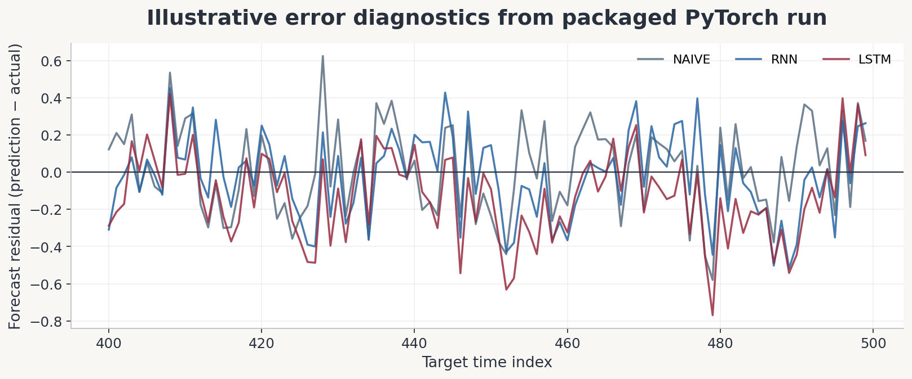{width="85%"}

- Inspect systematic bias and temporal clustering.
- Compare residual scale with a naive baseline.
- Check error by regime, not just aggregate RMSE.

::: {.small}
Residuals derive from the packaged Python demonstration; results are dataset-specific.
:::

:::::

::: {.notes}
**Instructor timing:** approximately 5 minute(s). **Section:** Extended four-hour lecture.

Timing: 5 minutes. A residual is prediction minus the realized target; clarify the sign convention. Show where recurrent forecasts miss peaks or transitions. High test RMSE could be driven by a few anomalies or sustained bias; the same scalar metric can conceal different failure modes. Compare against the persistence residuals at the same times. Discuss autocorrelation of residuals as a diagnostic for unmodeled temporal structure. A confident scientific conclusion should include multiple runs and statistical uncertainty, especially with neural-network random initialization. State that this plot is from a synthetic instructional series and is not field evidence for financial or clinical forecasting.

**Discussion prompt:** Ask students to justify one assumption, interpretation, or step on this slide; confirm that they can distinguish an illustrative example from a measured experimental result.
:::

## PyTorch: model definitions

::::: {.slide-content .has-code}

```{.python}
class SequenceRegressor(nn.Module):
    def __init__(self, kind):
        super().__init__()
        self.core = (nn.RNN(1, 16, batch_first=True)
                     if kind == "rnn" else
                     nn.LSTM(1, 16, batch_first=True))
        self.head = nn.Linear(16, 1)

    def forward(self, x):
        states, _ = self.core(x)
        return self.head(states[:, -1, :])
```

::: {.small}
Full source: `python/train_models.py`.
:::

:::::

::: {.notes}
**Instructor timing:** approximately 2 minute(s). **Section:** Implementation.

Highlight batch_first=True and states[:, -1, :] selecting the final recurrent output from all timesteps. The model head produces a scalar prediction for each sample. Explain recurrent output and returned final hidden state are related but not identical interfaces in PyTorch.

**Expanded four-hour teaching guidance:** Explain PyTorch tensor convention (batch, timestep, feature) with batch_first=True. The recurrent module returns all timestep states plus final recurrent states; for a many-to-one model the Dense-like linear head reads the last timestep. Distinguish NN module definition from data preparation, optimizer, and loss function.

**Checkpoint:** Before advancing, ask one learner to restate the central equation or diagram in their own words. If the class is unsure, repeat the numerical or graphical interpretation; use the next slide only after resolving the mismatch.

::: 

## PyTorch: a training step

::::: {.slide-content .has-code}

```{.python}
for xb, yb in train_loader:
    optimizer.zero_grad()
    pred = model(xb)
    loss = loss_fn(pred, yb)
    loss.backward()                   # BPTT
    nn.utils.clip_grad_norm_(
        model.parameters(), 1.0)      # stability
    optimizer.step()
```

::: {.takeaway}
`loss.backward()` differentiates through the **unrolled recurrent computations**.
:::

:::::

::: {.notes}
**Instructor timing:** approximately 2 minute(s). **Section:** Implementation.

Explain the five recurring actions in a gradient-based training loop. Note that clipping comes after gradient computation and before parameter update. Full script uses early stopping based on validation loss.

**Expanded four-hour teaching guidance:** Read the training loop out loud: clear old gradients, forward prediction, compute error, backward propagation, clip computed gradients, update weights. Stress why forgetting zero_grad accumulates gradients across mini-batches. During validation, switch to eval and disable gradient tracking with no_grad.

**Checkpoint:** Before advancing, ask one learner to restate the central equation or diagram in their own words. If the class is unsure, repeat the numerical or graphical interpretation; use the next slide only after resolving the mismatch.

::: 

## PyTorch tensor and return-value pitfalls

::::: {.slide-content}

```{.python}
core = torch.nn.LSTM(1, 16, batch_first=True)
sequence_states, (h_last, c_last) = core(x)
# x: (N, T, 1); sequence_states: (N, T, 16)
pred = head(sequence_states[:, -1, :])
```

::: {.question}
Why does `sequence_states[:, -1, :]` refer to the **last timestep** only when `batch_first=True`?
:::

:::::

::: {.notes}
**Instructor timing:** approximately 5 minute(s). **Section:** Extended four-hour lecture.

Timing: 5 minutes. Emphasize that -1 indexes the final element of the second axis because batch_first=True gives (batch,time,features). Without batch_first, many older PyTorch examples use (time,batch,features), and the same indexing expression would be wrong. The LSTM returns both hidden and cell state tuples, while a plain RNN returns a simpler hidden state. Discuss matching device, dtype and batch size when carrying states. For variable length padded sequences, simply taking the last padded timestep may be incorrect; use valid lengths, packed sequences, or masked pooling as appropriate.

**Discussion prompt:** Ask students to justify one assumption, interpretation, or step on this slide; confirm that they can distinguish an illustrative example from a measured experimental result.
:::

## Observed PyTorch test predictions

::::: {.slide-content}

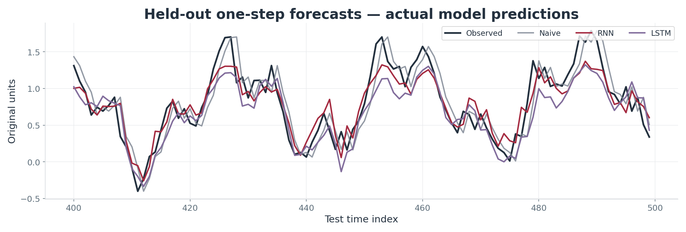{width="98%"}

::: {.small}
The plotted predictions were produced by running the provided script on the **synthetic** dataset (seed 42); one-step-ahead evaluation.
:::

:::::

::: {.notes}
**Instructor timing:** approximately 2 minute(s). **Section:** Implementation.

Make clear this is an actual execution, not schematic data. Encourage students to inspect periods where RNN/LSTM smooth rapid oscillations and to explain why a naive last-value baseline might be competitive. We do not claim these results generalize to real datasets.

**Expanded four-hour teaching guidance:** The included forecast plot comes from the packaged Python experiment rather than a hand-drawn ideal result. The comparison demonstrates that a neural network may lose against a naive baseline. Interpret where models lag, oversmooth, or shift peaks; do not claim any one recurrent model must win.

**Checkpoint:** Before advancing, ask one learner to restate the central equation or diagram in their own words. If the class is unsure, repeat the numerical or graphical interpretation; use the next slide only after resolving the mismatch.

::: 

## Compare results and diagnose

::::: {.slide-content}

| Model | Test RMSE (original units) |
|---|---:|
| Naive (last observation) | **0.2425** |
| PyTorch RNN | **0.2244** |
| PyTorch LSTM | **0.2635** |

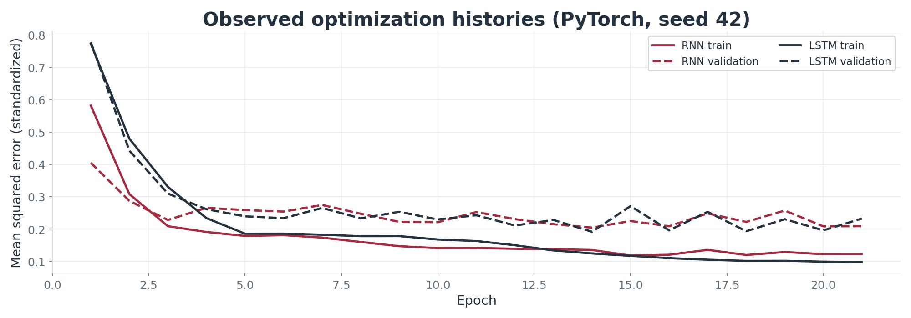{width="85%"}

::: {.takeaway}
In this single reproducible run, **RNN had the lowest test RMSE**. LSTM is not automatically better.
:::

:::::

::: {.notes}
**Instructor timing:** approximately 2 minute(s). **Section:** Implementation.

The figures and values are derived from executed PyTorch code for the provided synthetic sample. Discuss random initialization, sample length, hidden width, hyperparameters, the chosen baseline, and repeated-seed uncertainty. Not a statistically powered model-comparison study.

**Expanded four-hour teaching guidance:** Ensure that R and Python use identical target indices, lookback length and train-only normalization. Their parameter initializations and training kernels differ, so numerical equality is not expected. Examine test RMSE and the shape of prediction errors. For scientific claims, repeat across seeds and data periods and report uncertainty.

**Checkpoint:** Before advancing, ask one learner to restate the central equation or diagram in their own words. If the class is unsure, repeat the numerical or graphical interpretation; use the next slide only after resolving the mismatch.

::: 

## Scientific uncertainty: repeat across seeds

::::: {.slide-content}

::: {.card}
One train/test split and one random seed do **not** establish a universal ranking.
:::

Suggested report for each model:

| Statistic | Why report it? |
|:--|:--|
| Mean test RMSE over seeds | Typical performance |
| Standard deviation / interval | Training variability |
| Training time and parameter count | Resource tradeoffs |
| Rolling-origin results | Temporal robustness |

::: {.question}
If an LSTM wins once but loses on four other seeds, what can we responsibly conclude?
:::

:::::

::: {.notes}
**Instructor timing:** approximately 5 minute(s). **Section:** Extended four-hour lecture.

Timing: 5 minutes. Define model randomness: initialization, mini-batch order, stochastic kernels and sometimes early stopping. Repeating across seeds helps characterize optimizer variability. However, it does not solve temporal nonstationarity or data-splitting bias. Use rolling evaluation to complement seeds. Distinguish standard deviation across seeds from uncertainty about a population forecasting process; a careful report must describe what varies. Ask students not to cherry-pick the best run or report improvement without baseline and uncertainty. If cost is high, provide a clear compute budget and report limited evidence honestly.

**Discussion prompt:** Ask students to justify one assumption, interpretation, or step on this slide; confirm that they can distinguish an illustrative example from a measured experimental result.
:::

## Classification metrics for imbalanced sequence tasks

::::: {.slide-content}

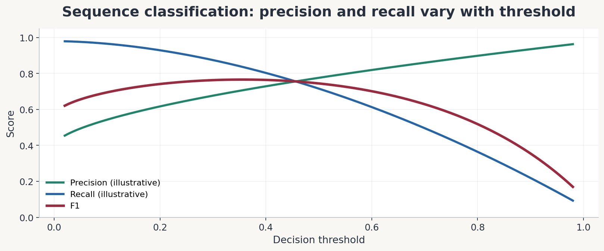{width="82%"}

$$\mathrm{Precision}=\frac{TP}{TP+FP},\quad \mathrm{Recall}=\frac{TP}{TP+FN}.$$

::: {.small}
Illustrative curves; real shape depends on classifier and dataset. For rare events, examine PR curves, not only accuracy.
:::

:::::

::: {.notes}
**Instructor timing:** approximately 5 minute(s). **Section:** Extended four-hour lecture.

Timing: 5 minutes. Define TP, FP and FN using a concrete anomaly-alert example. High recall retrieves most events but may cause many false positives. Precision asks how many predicted alerts are true, which becomes crucial when anomalies are rare. Explain F1 as harmonic mean rather than a universal measure of operational utility. The plotted curves are illustrative and should not be cited as empirical model results. Link threshold decisions to actual costs and prevalence. For sentiment tasks, report macro-F1 if classes are imbalanced; for sequential event tasks, decide whether evaluation is per-timestep, per-window or per-event.

**Discussion prompt:** Ask students to justify one assumption, interpretation, or step on this slide; confirm that they can distinguish an illustrative example from a measured experimental result.
:::

## Application: sentiment classification

::::: {.slide-content}

**Input:** a token/embedding sequence $E\in\mathbb R^{T\times d}$.

::: {.card}
Embeddings → recurrent encoder → final hidden state → dense classifier.
:::

- Binary sentiment: sigmoid probability or logits with BCE loss.
- Important details: tokenization, padding, masks, vocabulary.
- Evaluate with accuracy and **F1** (especially under imbalance).

::: {.takeaway}
A recurrent encoder is one design choice; modern attention-based encoders are also common.
:::

:::::

::: {.notes}
**Instructor timing:** approximately 2 minute(s). **Section:** Applications.

This is an application transfer, not a second live coding task. Clarify that embeddings are numeric vectors, not raw words. Different sequence lengths are padded and masked. Model comparison must use a proper independent test set.

**Expanded four-hour teaching guidance:** Walk the full NLP pipeline: tokenize, map to integer IDs, embed, handle padding, apply recurrent model, map hidden state to classes, and evaluate accuracy plus F1. Explain what makes training/test leakage possible in text, such as near-duplicate reviews. An LSTM is not guaranteed to beat a simpler bag-of-words baseline for small datasets.

**Checkpoint:** Before advancing, ask one learner to restate the central equation or diagram in their own words. If the class is unsure, repeat the numerical or graphical interpretation; use the next slide only after resolving the mismatch.

::: 

## From tokens to an LSTM classifier

::::: {.slide-content}

**Text processing chain**

```text
"not very good" → tokenizer → integer IDs
     ↓
embedding vectors (T × E)
     ↓
LSTM hidden/cell states
     ↓
classification head → class probabilities
```

::: {.takeaway}
Fit vocabulary and preprocessing rules on the **training corpus**; evaluate on unseen documents.
:::

:::::

::: {.notes}
**Instructor timing:** approximately 5 minute(s). **Section:** Extended four-hour lecture.

Timing: 5 minutes. Walk through short text “not very good” and why token order matters. Tokenization maps strings into discrete IDs, and embedding lookup maps each token to a vector. Padded batches need masks or proper lengths; the LSTM reads an ordered sequence of vectors. A classification head maps a final or pooled representation to class logits and probabilities after an appropriate activation or loss. Explain that tokenizer fitting on the full corpus can leak vocabulary statistics; the severity depends on the design but a training-only pipeline is safest. Compare bag-of-words and transformer baselines. Stress the lecture is about general architecture, not a claim of human-like language comprehension.

**Discussion prompt:** Ask students to justify one assumption, interpretation, or step on this slide; confirm that they can distinguish an illustrative example from a measured experimental result.
:::

## Application: multivariate anomaly detection

::::: {.slide-content}

{width="94%"}

A multivariate sequence window has shape $T\times F$ with $F>1$.

- Predict next values **or** reconstruct normal windows.
- Score residual size; flag observations above a calibrated threshold.
- Inspect **false alarms**, drift, and changing context.

:::::

::: {.notes}
**Instructor timing:** approximately 2 minute(s). **Section:** Applications.

Describe the plot as synthetic with an intentionally injected unusual interval. A predictive LSTM can learn normal trajectories, while high residuals become anomaly candidates. Threshold selection must avoid contamination and use appropriate validation data.

**Expanded four-hour teaching guidance:** Discuss monitoring as a separate task with multivariate inputs and a score for each window. A high score can reflect novelty, seasonality, sensor failure, or genuine fault; labeling requires domain context. Calibrate thresholds on held-out representative data and control false alarms. Explain the difference between detecting unusual observations and diagnosing a cause.

**Checkpoint:** Before advancing, ask one learner to restate the central equation or diagram in their own words. If the class is unsure, repeat the numerical or graphical interpretation; use the next slide only after resolving the mismatch.

::: 

## Calibrating anomaly-score thresholds

::::: {.slide-content}

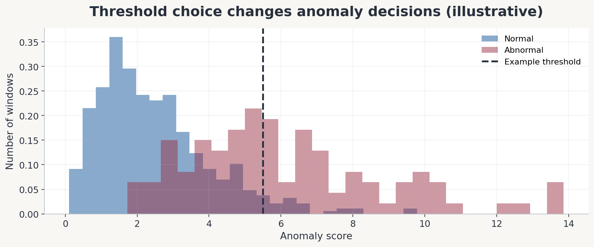{width="82%"}

- Higher thresholds usually reduce alerts and can miss anomalies.
- Lower thresholds increase sensitivity and potentially false alarms.
- Choose thresholds with **validation information**, not test labels.

::: {.small}
Illustrative synthetic score distributions, not observed operational results.
:::

:::::

::: {.notes}
**Instructor timing:** approximately 5 minute(s). **Section:** Extended four-hour lecture.

Timing: 5 minutes. Anomaly systems typically produce continuous scores, not categorical truths. A threshold converts scores into alerts, trading sensitivity against false positives. In an unlabelled setting, thresholds may be based on quantiles or expected alert burden, but those choices require operational assumptions. With labeled validation events, precision, recall and PR curves may be informative; with rare events, accuracy is often misleading. Explain false-positive costs in industrial monitoring and false-negative costs in safety-critical systems. Calibration and drift monitoring are necessary after deployment. Do not present the distribution chart as a real-world benchmarking result.

**Discussion prompt:** Ask students to justify one assumption, interpretation, or step on this slide; confirm that they can distinguish an illustrative example from a measured experimental result.
:::

## RNN vs LSTM vs GRU vs Transformer

::::: {.slide-content}

| Model | Main characteristic | Typical tradeoff |
|:--|:--|:--|
| Vanilla RNN | Simple recurrent state | Struggles with some long dependencies |
| LSTM | Cell state + multiple gates | Heavier recurrent computation |
| GRU | Gated, fewer gate families | Often simpler than LSTM |
| Transformer | Attention across positions | Different context/memory costs |

::: {.small}
There is **no universal winner**. Prefer evidence from a leak-free task-specific experiment.
:::

:::::

::: {.notes}
**Instructor timing:** approximately 2 minute(s). **Section:** Applications.

Explain LSTM and GRU are recurrent, while Transformers use attention rather than the same recurrence. Comparisons depend on sequence length, parallelism, data, task, latency and hardware. Avoid claiming one strictly dominates all other architectures.

**Expanded four-hour teaching guidance:** Compare models by recurrence, gate count, parallelization and resource needs. GRU uses update and reset gates, while transformer self-attention changes the computation pattern. For lengthy contexts, attention can incur large memory costs, and recurrent inference can be attractive when streaming. Avoid absolutist performance rankings.

**Checkpoint:** Before advancing, ask one learner to restate the central equation or diagram in their own words. If the class is unsure, repeat the numerical or graphical interpretation; use the next slide only after resolving the mismatch.

::: 


:::

## How should we choose?

::::: {.slide-content}

::: {.question}
**A defensible model-selection checklist**

1. What is the **forecasting or classification target**?
2. What is the **time-ordered validation protocol**?
3. Which **simple baseline** must be beaten?
4. How long are dependencies; how many features?
5. Are compute, latency, and interpretability important?
:::

::: {.takeaway}
Choose a model by **task-specific evidence**, not architecture popularity.
:::

:::::

::: {.notes}
**Instructor timing:** approximately 2 minute(s). **Section:** Applications.

Connect with graduate-level scientific practice. Repeated seeds and confidence intervals for empirical comparisons are preferable to a one-run anecdote. Ask students which baseline they would use for each of the three application families.

**Expanded four-hour teaching guidance:** Treat model selection as an empirical question. Begin with a good baseline, then compare architectures under matched data and tuning budgets. Account for sequence length, latency, hardware, interpretability, drift, and failure costs. Emphasize chronological evaluation and the distinction between in-sample fit and deployment performance.

**Checkpoint:** Before advancing, ask one learner to restate the central equation or diagram in their own words. If the class is unsure, repeat the numerical or graphical interpretation; use the next slide only after resolving the mismatch.

::: 

## Further reading and next steps

::::: {.slide-content}

::: {.small}
- Elman, J. (1990). *Finding structure in time*. Cognitive Science.  
- Bengio, Y., Simard, P., & Frasconi, P. (1994). *Learning long-term dependencies with gradient descent is difficult*. IEEE TNN.  
- Hochreiter, S., & Schmidhuber, J. (1997). *Long Short-Term Memory*. Neural Computation.  
- Gers, F. A., Schmidhuber, J., & Cummins, F. (2000). *Learning to Forget: Continual Prediction with LSTM*. Neural Computation.  
- Vaswani, A., et al. (2017). *Attention Is All You Need*. NeurIPS.
:::

**Practice:** Run both scripts; repeat across multiple seeds; compare with the naive baseline.  
**Resources:** `references.bib` · `R/` · `python/` · `instructor_guide.md`.

:::::

::: {.notes}
**Instructor timing:** approximately 1 minute(s). **Section:** Conclusions.

Close on research evaluation: students should be able to interpret, not simply reproduce, models. The papers are foundational; refer students to the official Keras3/PyTorch documentation included in README for syntax.

**Expanded four-hour teaching guidance:** Distinguish historical foundational readings from current software API references. Set independent tasks: rerun both implementations, replace the synthetic data with another appropriate sequence, report a naive baseline and test error, and analyze errors across time. Close by inviting the audience to question not only model accuracy but also leakage, reproducibility, and operational relevance.

**Checkpoint:** Before advancing, ask one learner to restate the central equation or diagram in their own words. If the class is unsure, repeat the numerical or graphical interpretation; use the next slide only after resolving the mismatch.

::: 
