---
# An explicit title slide is authored below; do not generate an automatic one.
format:
  revealjs:
    theme: [default, styles.scss]
    width: 1280
    height: 720
    margin: 0.04
    controls: true
    progress: true
    hash: true
    transition: fade
    navigation-mode: linear
    slide-number: c
    show-slide-number: all
    center: false
    auto-stretch: false
    scrollable: false
    code-overflow: wrap
    html-math-method: mathjax
    footer: "Muhammad Zikriya  |  Deep Learning for Sequential Data"
execute:
  enabled: false
---

## Recurrent Neural Networks & LSTMs {.title-slide .nostretch}

<div class="title-kicker">DEEP LEARNING FOR SEQUENTIAL DATA</div>

<div class="title-subtitle">From recurrent states to gated memory</div>

<div class="title-presenter">Muhammad Zikriya</div>

<div class="title-art">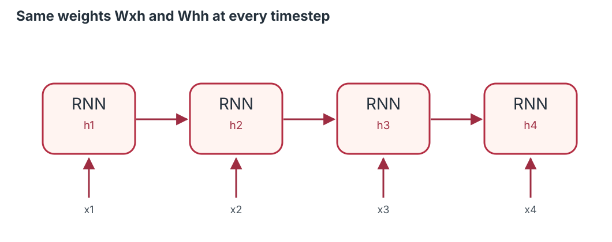</div>

<!-- UFPE AND GEDAI: ONLY ON THIS FIRST SLIDE. Fixed dimensions also work if custom CSS fails. -->
<div class="title-logo-row" style="display:flex; justify-content:center; align-items:center; gap:18px; max-width:560px; margin:28px auto 0; padding:0;">
<div class="title-logo-card" style="width:225px; max-width:45%; height:100px; background:#ffffff; border-radius:10px; display:flex; align-items:center; justify-content:center; padding:7px 10px; box-sizing:border-box;">

  </div>
<div class="title-logo-card" style="width:225px; max-width:45%; height:100px; background:#ffffff; border-radius:10px; display:flex; align-items:center; justify-content:center; padding:7px 10px; box-sizing:border-box;">

</div>
</div>

::: {.notes}
**Opening (instructor):** Introduce sequential data, recurrent networks, and why gated memory is useful. Explain that the lecture combines mathematical intuition, worked calculations, and experiments in R and Python.
:::

## Why does order matter?

::::: {.slide-content}

::: {.columns}
::: {.column width="52%"}
- "The dog chased the child" vs "The child chased the dog".
- In forecasting, yesterday may help predict tomorrow.
- In monitoring, an unusual *pattern* may matter more than one unusual value.

::: {.takeaway}
A sequence is **more than a set of observations**.
:::
:::
::: {.column width="48%"}
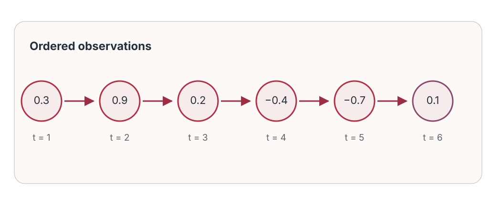
:::
:::

:::::

::: {.notes}
**Instructor timing:** approximately 2 minute(s). **Section:** Introduction.

Ask: If we permute the order of a sentence or hourly temperature readings, does the interpretation remain? Not usually. Point out that ordering, dependency, and variable sequence lengths motivate recurrent computation.
::: 

## Prediction challenge: what comes next?

::::: {.slide-content}

::: {.question}
**Quick poll (40 seconds):**  2, 4, 6, 8, **?**
:::

::: {.fragment}
Easy when the rule is local and clear: **10**.
:::

::: {.fragment}
But real sequences can contain delayed effects, noise, nonlinearity, and evolving regimes.
:::

::: {.card}
A model needs a representation of **what has happened so far**.
:::

:::::

::: {.notes}
**Instructor timing:** approximately 2 minute(s). **Section:** Introduction.

Reveal the obvious next term after students respond. Explain that realistic sequences are not tidy arithmetic progressions; prior context can be uncertain or many steps old. Transition to hidden state as a learned summary of history.
::: 

## Learning roadmap

::::: {.slide-content}

1. **Represent** sequential data and tasks.
2. **Derive** the RNN hidden-state update.
3. **Understand** BPTT and gradient instability.
4. **Derive** the LSTM gates and cell-state update.
5. **Implement** one-step forecasting in R and Python.
6. **Evaluate** against a sensible baseline.

::: {.takeaway}
Our teaching sequence: intuition → architecture → mathematics → calculation → code → interpretation.
:::

:::::

::: {.notes}
**Instructor timing:** approximately 2 minute(s). **Section:** Introduction.

State what success looks like: students can recognize input shapes, compute a scalar RNN step, explain vanishing gradients, reason through gate values, and critique a forecasting comparison. Keep this motivational rather than technical.
::: 

## What is sequential data?

::::: {.slide-content}

A sequence is an **ordered collection**:

$$\mathbf{x}_{1:T}=(\mathbf{x}_1,\mathbf{x}_2,\ldots,\mathbf{x}_T).$$

- $t$ indexes position or time.
- $\mathbf{x}_t\in\mathbb{R}^{F}$ can contain **multiple features**.
- Current observations may depend on earlier ones.

{width="85%"}

:::::

::: {.notes}
**Instructor timing:** approximately 2 minute(s). **Section:** Sequential data.

Explain the difference between a time-series dataset and an unordered table. Real datasets can have regularly spaced timestamps, irregular intervals, and missing data; recurrent layers do not automatically solve irregular sampling. Describe x_t as a vector when there are several sensors.
::: 

## Three application families

::::: {.slide-content}

::: {.columns}
::: {.column width="50%"}
**Forecasting**  
Predict future demand, load, or temperature.

**Language**  
Classify sentiment or tag words in sentences.

**Monitoring**  
Score multivariate sensor windows for abnormal behavior.
:::
::: {.column width="50%"}
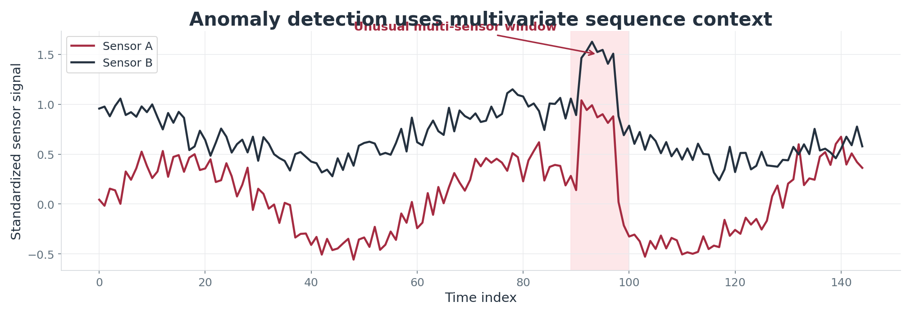{width="100%"}
:::
:::

:::::

::: {.notes}
**Instructor timing:** approximately 2 minute(s). **Section:** Sequential data.

Make clear that anomaly detection can be prediction-based, reconstruction-based, or discriminative. Today the detailed implementation is forecasting; text and anomaly detection are conceptual transfer examples.
::: 

## Why not just a feedforward network?

::::: {.slide-content}

::: {.card}
A feedforward network can learn from a **fixed-size lag window**—and may work very well.
:::

- But its input length is chosen in advance.
- A recurrent model updates a **state** at each timestep.
- The same transition function is reused as a sequence grows.

::: {.takeaway}
RNNs provide an explicit sequential inductive bias, **not a guarantee of better accuracy**.
:::

:::::

::: {.notes}
**Instructor timing:** approximately 2 minute(s). **Section:** Sequential data.

Avoid the misleading claim that feedforward networks cannot handle sequences. Explain that one can flatten 24 historical readings into a 24-dimensional vector, but recurrence processes ordered inputs with shared state-update parameters.
::: 

## Sequence-to-output patterns

::::: {.slide-content}

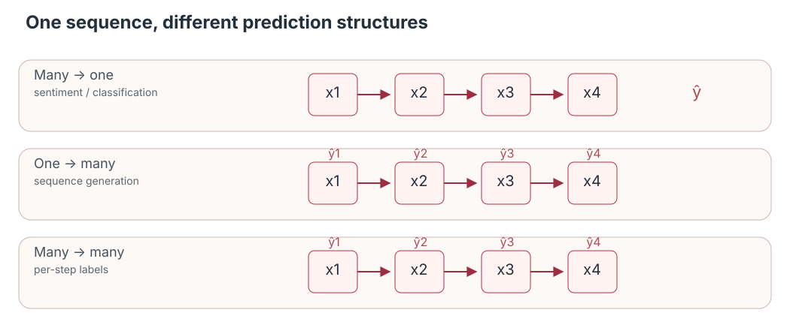{width="96%"}

::: {.small}
- **Many → one:** sentiment classification or next-value forecasting.
- **Many → many:** word tagging or per-timestep anomaly scores.
- **One → many:** output sequence generation with an appropriate decoder.
:::

:::::

::: {.notes}
**Instructor timing:** approximately 2 minute(s). **Section:** Sequential data.

Point at the corresponding outputs. Explain that many-to-one often uses a final state, and many-to-many often uses every state. One-to-many tasks typically require a decoder and cannot be fully specified by drawing only a single recurrent cell.
::: 

## Tensor shapes: the practical foundation

::::: {.slide-content}

For batch-first recurrent layers:

$$\boxed{X\in\mathbb{R}^{N\times T\times F}}$$

| Symbol | Meaning | Example |
|:--|:--|--:|
| $N$ | batch size | 32 |
| $T$ | timesteps (lookback) | 24 |
| $F$ | features per step | 1 |

::: {.question}
What shape represents 32 windows, each with 24 days and 3 sensors? **(32, 24, 3)**
:::

:::::

::: {.notes}
**Instructor timing:** approximately 2 minute(s). **Section:** Sequential data.

Ask students for the three numbers before revealing. Python PyTorch uses batch_first=True; Keras typically expects (batch, timesteps, features). Explain that training examples are not independent across chronological windows even when organized into batches.
::: 

## The key idea: carry a hidden state

::::: {.slide-content}

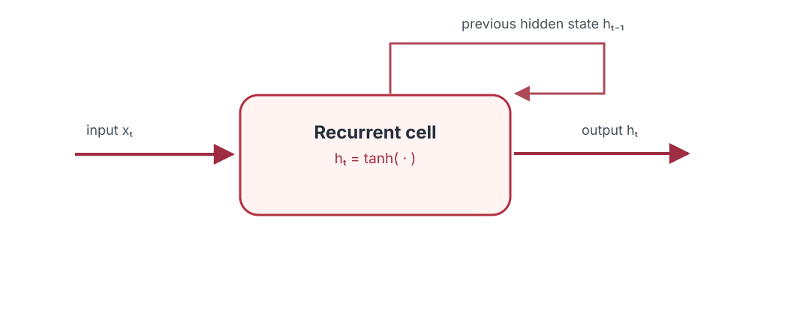{width="90%"}

At each step:

$$\boxed{\mathbf{h}_t=f(\mathbf{x}_t,\mathbf{h}_{t-1})}$$

::: {.takeaway}
$\mathbf{h}_t$ is a **learned representation** of the sequence prefix—not a perfect copy of the past.
:::

:::::

::: {.notes}
**Instructor timing:** approximately 2 minute(s). **Section:** Sequential data.

Explain hidden state as a compressed, task-relevant summary. The state updates using the current input and previous state; information can be lost. Transition to the precise tanh update next.
::: 

## What is a vanilla RNN?

::::: {.slide-content}

- A **recurrent transition** maps current input and previous hidden state to a new hidden state.
- A **readout layer** maps hidden state to a prediction.
- Weights are **shared** across sequence positions.

{width="80%"}

:::::

::: {.notes}
**Instructor timing:** approximately 2 minute(s). **Section:** Vanilla RNNs.

Emphasize that unrolling is a computational diagram, not physically stacking separate independently trained networks. Different timesteps use the exact same transition parameters. Hidden state is not automatically long-term memory.
::: 

## Inside a recurrent cell

::::: {.slide-content .has-code}

::: {.columns}
::: {.column width="58%"}
$$\mathbf{a}_t=W_{xh}\mathbf{x}_t+W_{hh}\mathbf{h}_{t-1}+\mathbf{b}_h$$

$$\mathbf{h}_t=\tanh(\mathbf{a}_t)$$

- $W_{xh}$ transforms input to hidden.
- $W_{hh}$ transfers previous hidden information.
- $\tanh$ bounds the state values to $(-1,1)$.
:::
::: {.column width="42%"}

:::
:::

:::::

::: {.notes}
**Instructor timing:** approximately 2 minute(s). **Section:** Vanilla RNNs.

Annotate each term. Explicitly note that tanh is an activation choice for the classical vanilla RNN; other nonlinearities are possible. Weight shapes are hidden_size × input_size and hidden_size × hidden_size.
::: 

## Unrolling through time

::::: {.slide-content}

{width="95%"}

::: {.fragment}
One diagram for each timestep; **one shared set of trainable parameters**.
:::

::: {.fragment}
Dependencies extend backward along the chain of hidden states.
:::

:::::

::: {.notes}
**Instructor timing:** approximately 2 minute(s). **Section:** Vanilla RNNs.

Show x1 to h1, then x2 to h2, and so on. Tie to matrix multiplication and the chain rule. Explain why each backward path becomes longer with temporal distance.
::: 

## Hidden-state equation and dimensions

::::: {.slide-content .has-code}

$$\boxed{\mathbf{h}_t=\tanh(W_{xh}\mathbf{x}_t+W_{hh}\mathbf{h}_{t-1}+\mathbf{b}_h)}$$

Let $F$ = input features and $H$ = hidden units.

$$W_{xh}\in\mathbb{R}^{H\times F},\quad W_{hh}\in\mathbb{R}^{H\times H},\quad \mathbf{b}_h\in\mathbb{R}^{H}.$$

::: {.card}
For $F=3$, $H=8$: input-to-hidden has **24** weights; hidden-to-hidden has **64** weights, excluding biases.
:::

:::::

::: {.notes}
**Instructor timing:** approximately 2 minute(s). **Section:** Vanilla RNNs.

Check shape compatibility: multiplying H×F by F×1 yields H×1, and H×H by H×1 also yields H×1. The 24 and 64 numbers are clear even before asking about total parameters.
::: 

## Worked example: two RNN steps

::::: {.slide-content .has-code}

**Scalar** values: $h_0=0$, $W_{xh}=0.5$, $W_{hh}=0.4$, $b=0$; $x_1=1$, $x_2=0$.

::: {.fragment}
$$h_1=\tanh(0.5\cdot1+0.4\cdot0)=\tanh(0.5)\approx0.4621.$$
:::

::: {.fragment}
$$h_2=\tanh(0.5\cdot0+0.4\cdot0.4621)\approx0.1828.$$
:::

::: {.takeaway}
Even with $x_2=0$, the second state can carry information from $x_1$.
:::

:::::

::: {.notes}
**Instructor timing:** approximately 2 minute(s). **Section:** Vanilla RNNs.

Give students 20 seconds to calculate h1. Then reveal h2. Numerical values are rounded, so the final result is approximate. Focus on the role of the previous hidden state rather than the tanh function itself.
::: 

## How an RNN produces an output

::::: {.slide-content}

A hidden state is usually **not** the final prediction.

$$\hat{\mathbf{y}}_t=g(W_{hy}\mathbf{h}_t+\mathbf{b}_y)$$

- **Regression:** often $g(z)=z$.
- **Binary classification:** often $g(z)=\sigma(z)$.
- **Multiclass classification:** often softmax.

::: {.card}
**Many-to-one** forecasting: pass the last hidden state to a regression head.
:::

:::::

::: {.notes}
**Instructor timing:** approximately 2 minute(s). **Section:** Vanilla RNNs.

Discuss that output activation depends on the task and loss function, not on RNN versus LSTM. For classification with cross-entropy, some libraries take logits directly without explicit sigmoid or softmax in forward().
::: 

## Why weight sharing matters

::::: {.slide-content}

::: {.columns}
::: {.column width="55%"}
- The same $W_{xh}$, $W_{hh}$, and $b_h$ act at every step.
- A learned pattern can be applied at different positions.
- Parameter count does not grow with the number of **unrolled timesteps**.
:::
::: {.column width="45%"}

:::
:::

::: {.takeaway}
Computation grows with sequence length; the core parameter count does not.
:::

:::::

::: {.notes}
**Instructor timing:** approximately 2 minute(s). **Section:** Vanilla RNNs.

Clarify the distinction between the number of repeated computational operations and number of learned weights. This is important for understanding runtime complexity and why long sequences can still be expensive.
::: 

## Application: short text sentiment

::::: {.slide-content}

::: {.card}
**Input:** “The movie was surprisingly good.”
:::

1. Convert tokens to numeric embeddings.
2. Update the hidden state once per token.
3. Map the final hidden state to a **sentiment logit**.
4. Optimize classification loss on labeled examples.

::: {.question}
Would exchanging “good” and “not” potentially change the label? **Yes.**
:::

:::::

::: {.notes}
**Instructor timing:** approximately 2 minute(s). **Section:** Vanilla RNNs.

This is a conceptual demonstration rather than a trained classifier. Explain embeddings are dense vectors representing words or subwords. RNNs see token order; the model must still learn semantics from data and labels.
::: 

## Activity: calculate the next state

::::: {.slide-content}

::: {.question}
For $h_{t-1}=0.2$, $x_t=-1$, $W_{xh}=0.6$, $W_{hh}=0.5$, $b=0.1$:

$$h_t=\tanh(0.6x_t+0.5h_{t-1}+0.1)$$

**Compute $h_t$ and interpret its sign.** (90 seconds)
:::

::: {.fragment}
Inside $\tanh$: $-0.6+0.1+0.1=-0.4$; therefore $h_t\approx-0.3799$.
:::

:::::

::: {.notes}
**Instructor timing:** approximately 3 minute(s). **Section:** Vanilla RNNs.

Allocate about 90 seconds for students to work and 90 seconds to discuss. The negative state value is a hidden representation, not necessarily a negative forecast. Ask one person to explain where the 0.1 term from the previous state came from.
::: 

## RNN summary and its limitation

::::: {.slide-content}

::: {.columns}
::: {.column width="50%"}
**What works**

- Order-aware state updates.
- Shared weights over time.
- Flexible sequence lengths.
:::
::: {.column width="50%"}
**What is difficult**

- Long-range dependencies.
- Sequential computation.
- Unstable gradient propagation.
:::
:::

::: {.takeaway}
Question for the next section: **why can early observations have so little influence on learning?**
:::

:::::

::: {.notes}
**Instructor timing:** approximately 3 minute(s). **Section:** Vanilla RNNs.

Use this slide to consolidate and transition. State that an RNN may learn short-range patterns well, but learning some distant dependencies can be hard because optimization signals must pass through many transitions.
::: 

## How does the network learn?

::::: {.slide-content .has-code}

For a sequence regression problem, a common objective is:

$$\mathcal{L}(\theta)=\frac1N\sum_{i=1}^N\big(\hat y_i-y_i\big)^2.$$

Parameter updates depend on:

$$\theta\leftarrow\theta-\eta\nabla_\theta\mathcal{L}.$$

::: {.card}
The gradient must account for **how an earlier hidden state influences later predictions**.
:::

:::::

::: {.notes}
**Instructor timing:** approximately 2 minute(s). **Section:** BPTT & gradients.

Define theta as all trainable parameters, eta as a learning rate, and MSE as a simple demonstration loss. Do not confuse an observation index i with sequence time index t. Loss may be summed over outputs at every timestep, depending on task.
::: 

## Backpropagation Through Time (BPTT)

::::: {.slide-content}

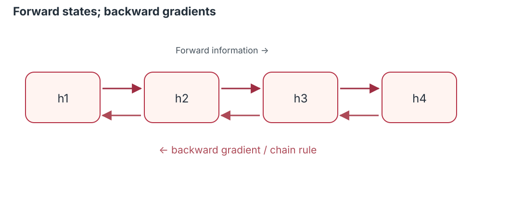{width="94%"}

1. Unroll the network for the observed window.
2. Compute predictions and loss.
3. Apply the chain rule through all unrolled operations.
4. Accumulate gradients for **shared weights**.

:::::

::: {.notes}
**Instructor timing:** approximately 2 minute(s). **Section:** BPTT & gradients.

Explain that ordinary backpropagation is applied to the unfolded computational graph. Shared weight matrices receive contributions from multiple timesteps. Many training frameworks perform BPTT automatically with autodifferentiation.
::: 

## Why long-range gradients are difficult

::::: {.slide-content}

For $k<t$, the chain rule gives:

$$\frac{\partial\mathbf h_t}{\partial\mathbf h_k}=\prod_{j=k+1}^{t}\frac{\partial\mathbf h_j}{\partial\mathbf h_{j-1}}.$$

::: {.small}
Repeated **Jacobian matrix products** can shrink or amplify gradients depending on their singular values, the weights, and activation derivatives.
:::

::: {.takeaway}
Long dependency paths can be hard to optimize even when information would be useful.
:::

:::::

::: {.notes}
**Instructor timing:** approximately 2 minute(s). **Section:** BPTT & gradients.

Use the product notation as a conceptual shorthand: matrix multiplication order is important. Explain that it is the local derivatives, not merely the weights, that determine gradient propagation. Avoid claiming every RNN necessarily has vanishing gradients.
::: 

## Vanishing gradients: a toy illustration

::::: {.slide-content}

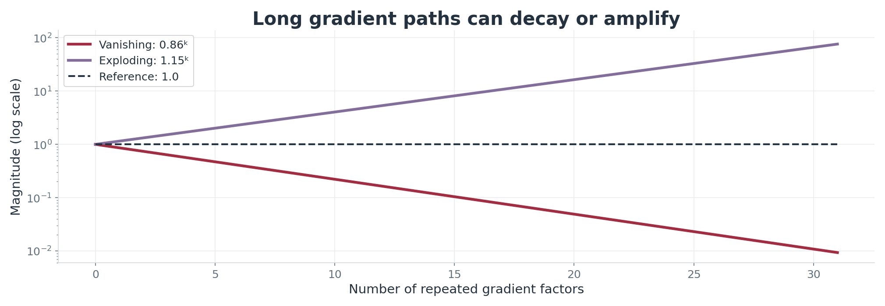{width="92%"}

::: {.card}
For a scalar repeated factor $0.65$: $0.65^{20}\approx0.00018$.
:::

Small updates to parameters handling distant history → **slow or ineffective learning**.

:::::

::: {.notes}
**Instructor timing:** approximately 2 minute(s). **Section:** BPTT & gradients.

Identify this chart as a stylized scalar analogy, not gradients measured in the network. The colored rising line is an exploding case and the declining line a vanishing case; the y axis is log scale. State that actual RNN gradients involve matrices and nonlinearities.
::: 

## Exploding gradients: instability

::::: {.slide-content}

A scalar repeated factor above 1 grows rapidly:

$$1.35^{20}\approx404.$$

- Updates may become erratic or numerically unstable.
- **Gradient norm clipping** limits the size of computed updates.
- Clipping is useful but does **not** create long-term memory.

::: {.takeaway}
Vanishing and exploding gradients are distinct phenomena requiring different mitigation strategies.
:::

:::::

::: {.notes}
**Instructor timing:** approximately 2 minute(s). **Section:** BPTT & gradients.

Explain that the displayed 404 is an illustrative scaling product, not a measured gradient. Show clipping as stabilizing optimization, not necessarily making generalization better. Point out that normalization and careful initialization can also help.
::: 

## Training strategies and tradeoffs

::::: {.slide-content}

| Strategy | Main purpose | Limitation |
|---|---|---|
| Gradient clipping | Bound excessive gradient norm | Does not fix vanishing |
| Truncated BPTT | Reduce backward graph length | Limits learning across longer spans |
| Orthogonal initialization | Improve recurrent dynamics | No universal solution |
| Gated cells (LSTM/GRU) | Learn selective memory updates | More parameters and compute |

:::::

::: {.notes}
**Instructor timing:** approximately 2 minute(s). **Section:** BPTT & gradients.

Define truncated BPTT correctly: the state can be carried forward while the gradient graph is detached at a chosen horizon. This distinguishes a finite training horizon from simply discarding all previous information.
::: 

## Think–pair–share: gradient directions

::::: {.slide-content}

::: {.question}
For a simplified scalar chain of **15 derivatives**:

1. What happens if the average multiplier is **0.7**?
2. What happens if it is **1.3**?
3. Why is this only an analogy for a real RNN?
:::

::: {.fragment}
$0.7^{15}\approx0.00475$; $1.3^{15}\approx51.2$.

The actual system multiplies **Jacobians**, not one scalar factor.
:::

:::::

::: {.notes}
**Instructor timing:** approximately 2 minute(s). **Section:** BPTT & gradients.

Spend about one minute collecting answers. Emphasize that students should not overgeneralize from the scalar example. If time allows, connect answers to gradients of recurrent weights near the beginning of a long sequence.
::: 

## Why better memory is needed

::::: {.slide-content}

::: {.columns}
::: {.column width="52%"}
A conventional RNN repeatedly **overwrites** a hidden representation.

A gated recurrent design can instead learn to:

- **retain** old information,
- **write** selected new information,
- **expose** relevant information.
:::
::: {.column width="48%"}
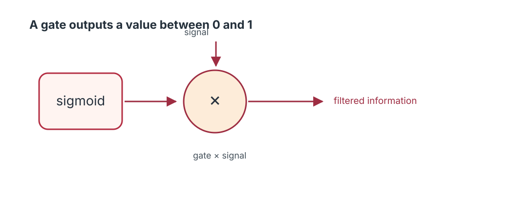
:::
:::

:::::

::: {.notes}
**Instructor timing:** approximately 2 minute(s). **Section:** BPTT & gradients.

Transition to LSTM intuitively: a model should choose which information to keep and which to replace. Do not claim the LSTM perfectly preserves long-term dependencies; it improves gradient paths under suitable gate settings.
::: 

## From RNN to LSTM

::::: {.slide-content}

**Long Short-Term Memory** was introduced to improve learning across long dependencies.

- Original work: Hochreiter & Schmidhuber (1997).
- Modern widely used equations include the **forget gate**, introduced later.
- An LSTM contains a **cell state** in addition to a hidden state.

::: {.takeaway}
Memory is controlled by **learned gates**, not simply carried forward unchanged.
:::

:::::

::: {.notes}
**Instructor timing:** approximately 2 minute(s). **Section:** LSTM.

Give historical context carefully: original LSTM 1997 and the learnable forget gate described by Gers et al. circa 2000. Today we teach the standard forget/input/output gated LSTM. Avoid saying LSTMs solve vanishing gradients under all conditions.
::: 

## The modern LSTM cell

::::: {.slide-content}

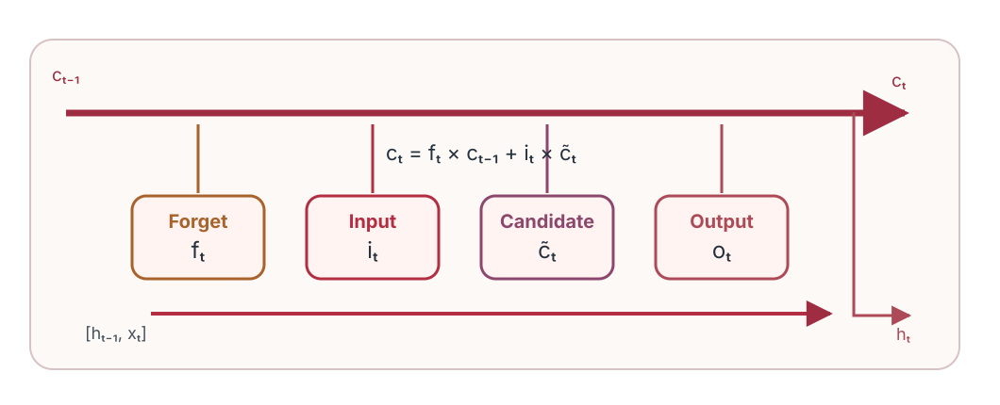{width="98%"}

::: {.small}
Simplified pedagogical schematic (not a complete tensor-level wiring diagram). The next slides define each gate mathematically.
:::

:::::

::: {.notes}
**Instructor timing:** approximately 2 minute(s). **Section:** LSTM.

Present the cell state as the long pathway and identify forget, input, candidate, and output transformations. The candidate is not a sigmoid gate; it is usually tanh. Note the diagram is conceptual, while the equations are authoritative.
::: 

## Two states: $c_t$ versus $h_t$

::::: {.slide-content}

::: {.columns}
::: {.column width="50%"}
::: {.card}
**Cell state $\mathbf c_t$**

Carries an evolving memory representation, updated **additively** by forgetting and writing.
:::
:::
::: {.column width="50%"}
::: {.card}
**Hidden state $\mathbf h_t$**

Controls what the cell **exposes** to the next layer or the prediction head.
:::
:::
:::

$$\mathbf c_t=\mathbf f_t\odot\mathbf c_{t-1}+\mathbf i_t\odot\tilde{\mathbf c}_t$$

:::::

::: {.notes}
**Instructor timing:** approximately 2 minute(s). **Section:** LSTM.

Students often confuse the two states. Emphasize that the cell state is internal memory and the hidden state is externally exposed output, although both are passed through recurrent computation. Both are vectors with hidden_size components.
::: 

## What is a gate?

::::: {.slide-content}

{width="89%"}

$$\sigma(z)=\frac{1}{1+e^{-z}}\in(0,1)$$

- Near **0**: suppress an information component.
- Near **1**: pass most of that component.
- Between: retain a fraction.

::: {.takeaway}
Gates are **vectors**; each memory component can be controlled differently.
:::

:::::

::: {.notes}
**Instructor timing:** approximately 2 minute(s). **Section:** LSTM.

Point out elementwise sigmoid, not a binary hard switch. A gate can take intermediate values. Demonstrate 0.8 times 0.4 gives 0.32. The gate values emerge from a learned affine transform of current input and previous hidden state.
::: 

## Forget gate: what to retain?

::::: {.slide-content .has-code}

$$\boxed{\mathbf f_t=\sigma(W_f[\mathbf h_{t-1},\mathbf x_t]+\mathbf b_f)}$$

The retained previous memory is:

$$\mathbf f_t\odot\mathbf c_{t-1}$$

::: {.fragment}
If $c_{t-1}=0.8$ and $f_t=0.25$, retained contribution is **0.20**.
:::

::: {.takeaway}
The forget gate controls the **old** component of memory.
:::

:::::

::: {.notes}
**Instructor timing:** approximately 2 minute(s). **Section:** LSTM.

Explain concatenation notation, which is a convenient presentation equivalent to separate linear transformations of h and x. Emphasize the scalar example is one component of a vector memory.
::: 

## Input gate: what to write?

::::: {.slide-content}

$$\boxed{\mathbf i_t=\sigma(W_i[\mathbf h_{t-1},\mathbf x_t]+\mathbf b_i)}$$

- High $i_t$: permit a stronger **new-information** contribution.
- Low $i_t$: reduce the candidate's influence.
- The gate is learned from both current input and previous hidden state.

::: {.question}
If $i_t=0$, can the candidate change the cell state at this step? **No**, not through the input term.
:::

:::::

::: {.notes}
**Instructor timing:** approximately 2 minute(s). **Section:** LSTM.

Distinguish input gate from input x_t; the gate is a learned controller that decides how much candidate content can enter memory. Cell state may still change via forgetting.
::: 

## Candidate memory: what to propose?

::::: {.slide-content}

$$\boxed{\tilde{\mathbf c}_t=\tanh(W_c[\mathbf h_{t-1},\mathbf x_t]+\mathbf b_c)}$$

- Candidate values lie between **−1 and 1**.
- Unlike the sigmoid gate, the candidate can be **positive or negative**.
- The actual contribution is $\mathbf i_t\odot\tilde{\mathbf c}_t$.

::: {.card}
**Gate × candidate** = controlled new information.
:::

:::::

::: {.notes}
**Instructor timing:** approximately 2 minute(s). **Section:** LSTM.

Students should learn that the candidate is not an extra independent memory or a sigmoid gate. It proposes values that the input gate scales. Mention that activation conventions can vary among implementation variants.
::: 

## Cell-state update: retain + write

::::: {.slide-content}

$$\boxed{\mathbf c_t=\mathbf f_t\odot\mathbf c_{t-1}+\mathbf i_t\odot\tilde{\mathbf c}_t}$$

::: {.fragment}
**Retain:** $f_t\odot c_{t-1}$  
**Write:** $i_t\odot\tilde c_t$
:::

::: {.takeaway}
The **additive** path is a central reason LSTM can propagate some gradients more effectively than a conventional RNN.
:::

:::::

::: {.notes}
**Instructor timing:** approximately 2 minute(s). **Section:** LSTM.

Use a physical notebook analogy if needed, but return to the actual equation. The cell state is not bounded to [0,1]; it can exceed 1 or become negative because the update is additive.
::: 

## Output gate: what to reveal?

::::: {.slide-content .has-code}

$$\boxed{\mathbf o_t=\sigma(W_o[\mathbf h_{t-1},\mathbf x_t]+\mathbf b_o)}$$

The output gate controls the **visible hidden state**, rather than directly overwriting cell memory.

::: {.fragment}
$$\mathbf h_t=\mathbf o_t\odot\tanh(\mathbf c_t)$$
:::

::: {.question}
If $o_t\approx0$, is the cell state necessarily erased? **No.**
:::

:::::

::: {.notes}
**Instructor timing:** approximately 2 minute(s). **Section:** LSTM.

A low output gate can conceal information from the exposed hidden state while maintaining it in cell state. Explain that the tanh maps cell-state values into a bounded range before output gating.
::: 

## Hidden-state calculation

::::: {.slide-content}

**Example:** $c_t=0.62$ and $o_t=0.7$.

$$h_t=0.7\,\tanh(0.62)\approx0.3858.$$

::: {.fragment}
The same cell state can produce different hidden states depending on the output gate.
:::

::: {.card}
**Many-to-one forecasting:** a dense layer maps the final $h_T$ to $\hat y$.
:::

:::::

::: {.notes}
**Instructor timing:** approximately 2 minute(s). **Section:** LSTM.

Demonstrate that tanh(0.62) is about 0.551, giving h about 0.386. The output gate gates the exposure of current cell state to the next layer or output head.
::: 

## All LSTM equations on one slide

::::: {.slide-content}

::: {.small}
$$\begin{aligned}
\mathbf f_t&=\sigma(W_f[\mathbf h_{t-1},\mathbf x_t]+\mathbf b_f)\\
\mathbf i_t&=\sigma(W_i[\mathbf h_{t-1},\mathbf x_t]+\mathbf b_i)\\
\tilde{\mathbf c}_t&=\tanh(W_c[\mathbf h_{t-1},\mathbf x_t]+\mathbf b_c)\\
\mathbf c_t&=\mathbf f_t\odot\mathbf c_{t-1}+\mathbf i_t\odot\tilde{\mathbf c}_t\\
\mathbf o_t&=\sigma(W_o[\mathbf h_{t-1},\mathbf x_t]+\mathbf b_o)\\
\mathbf h_t&=\mathbf o_t\odot\tanh(\mathbf c_t)
\end{aligned}$$
:::

::: {.takeaway}
**Forget → propose/write → update cell → expose hidden.**
:::

:::::

::: {.notes}
**Instructor timing:** approximately 2 minute(s). **Section:** LSTM.

Identify each symbol one more time. Explain W matrices include a concatenation of hidden and input transformations, and ⊙ means elementwise multiplication. This is the modern no-peephole pedagogical variant.
::: 

## Worked example: one complete LSTM step

::::: {.slide-content .has-code}

Given $c_{t-1}=0.4$, $f_t=0.8$, $i_t=0.5$, $\tilde c_t=0.6$, $o_t=0.7$:

::: {.fragment}
$$c_t=0.8(0.4)+0.5(0.6)=0.32+0.30=\boxed{0.62}.$$
:::

::: {.fragment}
$$h_t=0.7\tanh(0.62)\approx\boxed{0.3858}.$$
:::

::: {.takeaway}
The gate values are given here; in a trained model they are **learned functions of the input and previous hidden state**.
:::

:::::

::: {.notes}
**Instructor timing:** approximately 2 minute(s). **Section:** LSTM.

Ask students to separate the two memory contributions before doing the final addition. Be explicit that values of f,i,o have been provided for this arithmetic exercise rather than derived from gate matrices.
::: 

## Why LSTM can help gradients

::::: {.slide-content}

Holding the **gate values fixed** locally, the cell-state update includes:

$$\frac{\partial\mathbf c_t}{\partial\mathbf c_{t-1}}\approx\mathrm{diag}(\mathbf f_t).$$

- If a forget component is near **1**, it can preserve a gradient pathway.
- The state update has an **additive branch**, reducing reliance on repeated saturated nonlinear transformations.
- Full derivatives include dependence of the gates on the previous state.

::: {.takeaway}
**Improved gradient pathways—not a mathematical guarantee against vanishing gradients.**
:::

:::::

::: {.notes}
**Instructor timing:** approximately 2 minute(s). **Section:** LSTM.

The approximation deliberately treats gate values as locally fixed; in the full network gates depend on h and therefore indirectly on past cell state. Avoid an overconfident claim that gradients never vanish. Discuss saturation and gate choices.
::: 

## Activity: control the gates

::::: {.slide-content}

::: {.question}
Assume $c_{t-1}=0.7$ and candidate $\tilde c_t=-0.4$.

**Case A:** $f_t=1, i_t=0$ → new $c_t$?  
**Case B:** $f_t=0, i_t=1$ → new $c_t$?  
**Case C:** $f_t=0.5, i_t=0.5$ → new $c_t$?
:::

::: {.fragment}
**Solutions:** A = 0.7, B = −0.4, C = 0.15.
:::

::: {.small}
If $o_t=0$, then $h_t=0$ regardless of these cell values.
:::

:::::

::: {.notes}
**Instructor timing:** approximately 2 minute(s). **Section:** LSTM.

Allocate one minute for arithmetic and one minute for interpretation. The exact gate values 0 and 1 are idealized endpoints; sigmoid outputs approach them but ordinarily do not equal them with finite logits. Reinforce that output gating does not delete cell state.
::: 

## Practical case study: forecast one step

::::: {.slide-content}

**Goal:** predict $y_t$ from the previous **24** values.

$$\underbrace{(y_{t-24},\ldots,y_{t-1})}_{\text{model input}}\longrightarrow\hat y_t$$

::: {.card}
We use a **synthetic, reproducible** 500-observation series with trend, periodic structure, and noise.
:::

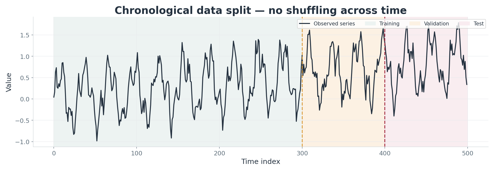{width="93%"}

:::::

::: {.notes}
**Instructor timing:** approximately 2 minute(s). **Section:** Implementation.

Explain the synthetic data is not a real-world empirical benchmark. The experiment uses one-step forecasting, 24 lookback timesteps, and one numeric target. More complex tasks can be added after students understand this pipeline.
::: 

## Chronological split and leakage

::::: {.slide-content}

{width="91%"}

- First **300** observations: training.
- Next **100**: validation / early stopping.
- Last **100**: untouched test targets.
- Estimate the **normalization mean and SD on training observations only**.

::: {.takeaway}
At each prediction time, inputs come only from **earlier** observations.
:::

:::::

::: {.notes}
**Instructor timing:** approximately 2 minute(s). **Section:** Implementation.

Clarify that validation and test windows can include historical observations from the previous partition, but never future target values. The model is evaluated on targets in each chronological partition. Random splitting of overlapping windows would leak information and inflate test performance.
::: 

## Creating sliding windows

::::: {.slide-content}

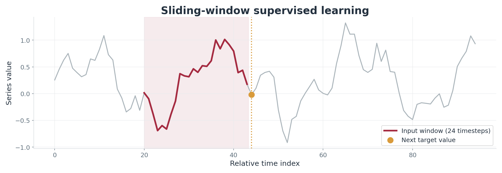{width="94%"}

$$X_i=[z_i,\ldots,z_{i+23}]\in\mathbb{R}^{24\times1},\quad y_i=z_{i+24}.$$

::: {.card}
The complete batch tensor has shape **(number of windows, 24, 1)**.
:::

:::::

::: {.notes}
**Instructor timing:** approximately 2 minute(s). **Section:** Implementation.

Explain z denotes scaled observations. A new sample is produced by sliding the window forward one time step. Overlapping input windows are acceptable because they are part of a time-series learning problem; do not randomly split them into train and test.
::: 

## Always include a baseline

::::: {.slide-content .has-code}

For one-step forecasting, the **persistence** baseline is:

$$\hat y_t^{\mathrm{naive}}=y_{t-1}.$$

The test-set root mean squared error is:

$$\mathrm{RMSE}=\sqrt{\frac1{n_{test}}\sum_{t\in\mathrm{test}}(\hat y_t-y_t)^2}.$$

::: {.takeaway}
A complex model should be compared against a relevant simple forecast.
:::

:::::

::: {.notes}
**Instructor timing:** approximately 2 minute(s). **Section:** Implementation.

Explain why persistence is strong for smooth, highly autocorrelated sequences. RMSE uses original measurement units after inverse scaling. One-step test evaluation here uses the last observed target value in each input window, not recursive forecasts.
::: 

## R implementation: vanilla RNN

::::: {.slide-content .has-code}

```{.r}
library(keras3)
model <- keras_model_sequential() |>
  layer_simple_rnn(units = 16,
                   input_shape = c(24, 1),
                   activation = "tanh") |>
  layer_dense(units = 1)
model |> compile(
  optimizer = optimizer_adam(0.01),
  loss = "mse"
)
```

::: {.small}
Full runnable script: `R/train_models.R` · Keras3/TensorFlow backend.
:::

:::::

::: {.notes}
**Instructor timing:** approximately 2 minute(s). **Section:** Implementation.

Walk through units=16, input shape excluding batch, last hidden state becoming dense output, regression head, and MSE. Explain that backend must be installed first and that the complete script handles preprocessing, train/validation/test, and evaluation.
::: 

## R implementation: replace RNN with LSTM

::::: {.slide-content .has-code}

```{.r}
model <- keras_model_sequential() |>
  layer_lstm(units = 16,
             input_shape = c(24, 1)) |>
  layer_dense(units = 1)
model |> compile(
  optimizer = optimizer_adam(0.01),
  loss = "mse"
)
```

::: {.takeaway}
The **data pipeline and evaluation protocol stay the same**; only the recurrent layer changes.
:::

:::::

::: {.notes}
**Instructor timing:** approximately 2 minute(s). **Section:** Implementation.

Students see how similar the high-level APIs are. Clarify that the number of trainable parameters changes because LSTM internally includes four affine transformations for gates and candidate.
::: 

## R: fit, validate, monitor

::::: {.slide-content .has-code}

```{.r}
history <- model |> fit(
  x = X[train, , , drop = FALSE],
  y = Y[train, , drop = FALSE],
  validation_data = list(
    X[valid, , , drop = FALSE],
    Y[valid, , drop = FALSE]),
  epochs = 35, batch_size = 32,
  callbacks = list(callback_early_stopping(
    monitor = "val_loss", patience = 7,
    restore_best_weights = TRUE)))
```

::: {.small}
Only the training partition drives gradient updates; validation guides early stopping.
:::

:::::

::: {.notes}
**Instructor timing:** approximately 2 minute(s). **Section:** Implementation.

Explain epochs and batches simply; patience counts epochs without validation improvement. The validation targets are not used directly in model gradient descent. In R, use the complete script for tensor creation.
::: 

## R: predict and assess test RMSE

::::: {.slide-content .has-code}

```{.r}
pred <- as.numeric(predict(
  model, X[test, , , drop = FALSE],
  verbose = 0)) * sigma + mu
rmse <- function(p, a) sqrt(mean((p-a)^2))
cat("test RMSE:", rmse(pred, actual))
```

::: {.takeaway}
**Inverse-transform** predictions before reporting RMSE in original units.
:::

::: {.small}
R outputs are generated when the R script runs; the deck does **not** invent R metric values.
:::

:::::

::: {.notes}
**Instructor timing:** approximately 2 minute(s). **Section:** Implementation.

Read the code from the outside in: test windows, model predictions in standardized units, multiply sigma and add mu, then calculate test RMSE. Explain that R results might differ from Python due to implementation and optimization details.
::: 

## PyTorch: model definitions

::::: {.slide-content .has-code}

```{.python}
class SequenceRegressor(nn.Module):
    def __init__(self, kind):
        super().__init__()
        self.core = (nn.RNN(1, 16, batch_first=True)
                     if kind == "rnn" else
                     nn.LSTM(1, 16, batch_first=True))
        self.head = nn.Linear(16, 1)

    def forward(self, x):
        states, _ = self.core(x)
        return self.head(states[:, -1, :])
```

::: {.small}
Full source: `python/train_models.py`.
:::

:::::

::: {.notes}
**Instructor timing:** approximately 2 minute(s). **Section:** Implementation.

Highlight batch_first=True and states[:, -1, :] selecting the final recurrent output from all timesteps. The model head produces a scalar prediction for each sample. Explain recurrent output and returned final hidden state are related but not identical interfaces in PyTorch.
::: 

## PyTorch: a training step

::::: {.slide-content .has-code}

```{.python}
for xb, yb in train_loader:
    optimizer.zero_grad()
    pred = model(xb)
    loss = loss_fn(pred, yb)
    loss.backward()                   # BPTT
    nn.utils.clip_grad_norm_(
        model.parameters(), 1.0)      # stability
    optimizer.step()
```

::: {.takeaway}
`loss.backward()` differentiates through the **unrolled recurrent computations**.
:::

:::::

::: {.notes}
**Instructor timing:** approximately 2 minute(s). **Section:** Implementation.

Explain the five recurring actions in a gradient-based training loop. Note that clipping comes after gradient computation and before parameter update. Full script uses early stopping based on validation loss.
::: 

## Observed PyTorch test predictions

::::: {.slide-content}

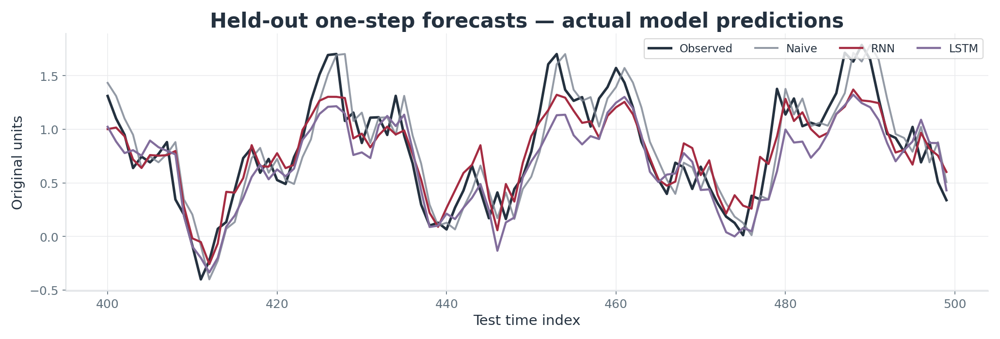{width="98%"}

::: {.small}
The plotted predictions were produced by running the provided script on the **synthetic** dataset (seed 42); one-step-ahead evaluation.
:::

:::::

::: {.notes}
**Instructor timing:** approximately 2 minute(s). **Section:** Implementation.

Make clear this is an actual execution, not schematic data. Encourage students to inspect periods where RNN/LSTM smooth rapid oscillations and to explain why a naive last-value baseline might be competitive. We do not claim these results generalize to real datasets.
::: 

## Compare results and diagnose

::::: {.slide-content}

| Model | Test RMSE (original units) |
|---|---:|
| Naive (last observation) | **0.2425** |
| PyTorch RNN | **0.2244** |
| PyTorch LSTM | **0.2635** |

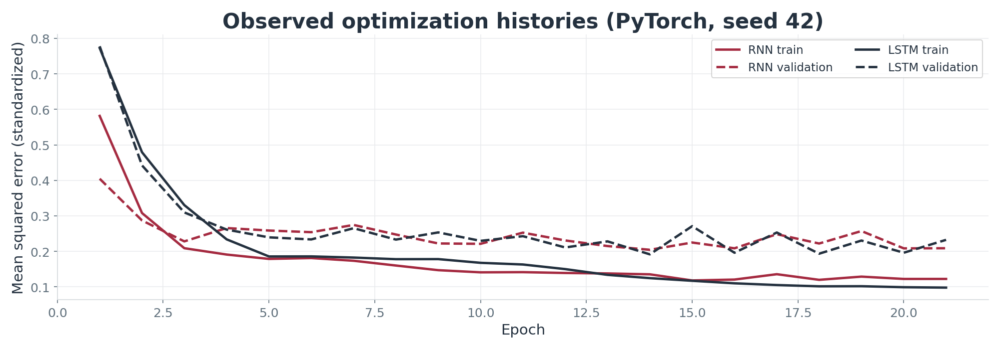{width="85%"}

::: {.takeaway}
In this single reproducible run, **RNN had the lowest test RMSE**. LSTM is not automatically better.
:::

:::::

::: {.notes}
**Instructor timing:** approximately 2 minute(s). **Section:** Implementation.

The figures and values are derived from executed PyTorch code for the provided synthetic sample. Discuss random initialization, sample length, hidden width, hyperparameters, the chosen baseline, and repeated-seed uncertainty. Not a statistically powered model-comparison study.
::: 

## Application: sentiment classification

::::: {.slide-content}

**Input:** a token/embedding sequence $E\in\mathbb R^{T\times d}$.

::: {.card}
Embeddings → recurrent encoder → final hidden state → dense classifier.
:::

- Binary sentiment: sigmoid probability or logits with BCE loss.
- Important details: tokenization, padding, masks, vocabulary.
- Evaluate with accuracy and **F1** (especially under imbalance).

::: {.takeaway}
A recurrent encoder is one design choice; modern attention-based encoders are also common.
:::

:::::

::: {.notes}
**Instructor timing:** approximately 2 minute(s). **Section:** Applications.

This is an application transfer, not a second live coding task. Clarify that embeddings are numeric vectors, not raw words. Different sequence lengths are padded and masked. Model comparison must use a proper independent test set.
::: 

## Application: multivariate anomaly detection

::::: {.slide-content}

{width="94%"}

A multivariate sequence window has shape $T\times F$ with $F>1$.

- Predict next values **or** reconstruct normal windows.
- Score residual size; flag observations above a calibrated threshold.
- Inspect **false alarms**, drift, and changing context.

:::::

::: {.notes}
**Instructor timing:** approximately 2 minute(s). **Section:** Applications.

Describe the plot as synthetic with an intentionally injected unusual interval. A predictive LSTM can learn normal trajectories, while high residuals become anomaly candidates. Threshold selection must avoid contamination and use appropriate validation data.
::: 

## RNN vs LSTM vs GRU vs Transformer

::::: {.slide-content}

| Model | Main characteristic | Typical tradeoff |
|:--|:--|:--|
| Vanilla RNN | Simple recurrent state | Struggles with some long dependencies |
| LSTM | Cell state + multiple gates | Heavier recurrent computation |
| GRU | Gated, fewer gate families | Often simpler than LSTM |
| Transformer | Attention across positions | Different context/memory costs |

::: {.small}
There is **no universal winner**. Prefer evidence from a leak-free task-specific experiment.
:::

:::::

::: {.notes}
**Instructor timing:** approximately 2 minute(s). **Section:** Applications.

Explain LSTM and GRU are recurrent, while Transformers use attention rather than the same recurrence. Comparisons depend on sequence length, parallelism, data, task, latency and hardware. Avoid claiming one strictly dominates all other architectures.
::: 

## How should we choose?

::::: {.slide-content}

::: {.question}
**A defensible model-selection checklist**

1. What is the **forecasting or classification target**?
2. What is the **time-ordered validation protocol**?
3. Which **simple baseline** must be beaten?
4. How long are dependencies; how many features?
5. Are compute, latency, and interpretability important?
:::

::: {.takeaway}
Choose a model by **task-specific evidence**, not architecture popularity.
:::

:::::

::: {.notes}
**Instructor timing:** approximately 2 minute(s). **Section:** Applications.

Connect with graduate-level scientific practice. Repeated seeds and confidence intervals for empirical comparisons are preferable to a one-run anecdote. Ask students which baseline they would use for each of the three application families.
::: 

## Five essential takeaways

::::: {.slide-content}

1. Sequential data carry meaning in **order and history**.
2. Vanilla RNNs repeatedly update a **shared hidden state**.
3. BPTT can yield **vanishing or exploding** gradients.
4. LSTM gates selectively **retain, write, and expose** memory.
5. Reliable experiments require **chronological splits and baselines**.

::: {.takeaway}
**Exit question:** Why is an additive cell-state path useful?
:::

:::::

::: {.notes}
**Instructor timing:** approximately 1 minute(s). **Section:** Conclusions.

Give students 30 seconds to answer the exit question. Expected answer: the additive update can preserve a more direct gradient path when forget gates are near one, helping certain long-range dependencies. It does not eliminate all instability.
::: 

## Further reading and next steps

::::: {.slide-content}

::: {.small}
- Elman, J. (1990). *Finding structure in time*. Cognitive Science.  
- Bengio, Y., Simard, P., & Frasconi, P. (1994). *Learning long-term dependencies with gradient descent is difficult*. IEEE TNN.  
- Hochreiter, S., & Schmidhuber, J. (1997). *Long Short-Term Memory*. Neural Computation.  
- Gers, F. A., Schmidhuber, J., & Cummins, F. (2000). *Learning to Forget: Continual Prediction with LSTM*. Neural Computation.  
- Vaswani, A., et al. (2017). *Attention Is All You Need*. NeurIPS.
:::

**Practice:** Run both scripts; repeat across multiple seeds; compare with the naive baseline.  
**Resources:** `references.bib` · `R/` · `python/` · `instructor_guide.md`.

:::::

::: {.notes}
**Instructor timing:** approximately 1 minute(s). **Section:** Conclusions.

Close on research evaluation: students should be able to interpret, not simply reproduce, models. The papers are foundational; refer students to the official Keras3/PyTorch documentation included in README for syntax.
::: 
